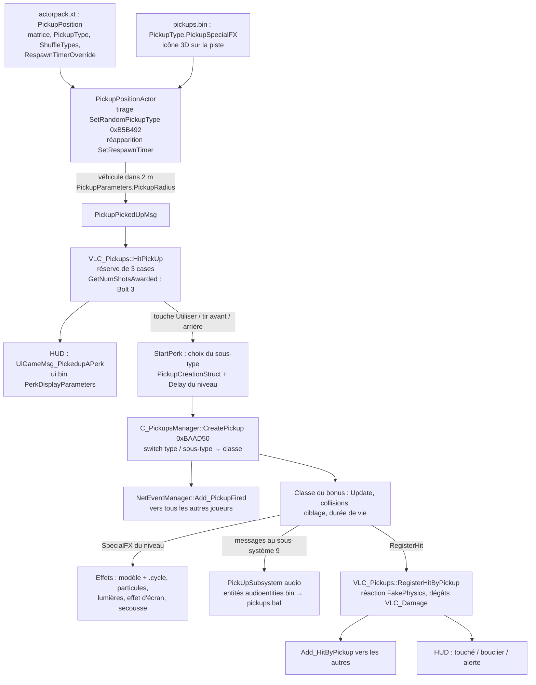

# Bonus (power-ups) de Blur : référence technique complète

Étude du 2026-11-17, faite en lecture seule (aucun fichier du jeu modifié). Ce document regroupe tout ce qu'on sait
des bonus : données, code, effets, son, HUD, caméras, IA, emplacements, LAN, réseau, DoubleTap. Il dit aussi comment
modifier ou créer un bonus. Les valeurs brutes de chaque bonus sont dans **`POWERUPS_DONNEES.md`**, généré par
`powerups_dump.py`. Les travaux du Railgun (CONNAISSANCES, « Bonus Railgun ») sont le premier cas pratique de ce
document.

Suite : **`POWERUP_BEHAVIOUR_STUDY.md`** (interactions entre bonus, bouclier, nature du Fan et du Stopwatch,
anomalies, plan de tests).

## 0. Sources et niveaux de confiance

| Source | Ce qu'elle prouve |
|---|---|
| `pickups.bin`, `ui.bin`, `multiplayer.bin`, `air.bin`, `audioentities.bin` (exports JSON `blur_extracted\xt_json`, schémas `blurxt.py`) | les **valeurs** : **Confirmé** (lues dans le fichier) |
| `Blur.exe` (chaînes, désassemblage déjà fait pour le Railgun) | ce que le jeu vendu contient vraiment : **Confirmé** |
| Code source fuité (`C:\Users\sanqu\Jeux_WII\blur_source\BlurRebuilt\code`, juin 2010) | le **comportement** : **Fort** |
| Essais en jeu (Railgun v1 à v7, essai « DoubleTap » du 2026-10-19) | **Confirmé en jeu** |

Échelle demandée → échelle du dépôt : CONFIRMED = **Confirmé**, STRONGLY SUPPORTED = **Fort**, HYPOTHESIS =
**Hypothèse**, UNKNOWN = **Inconnu**.

**Attention au code source.** Il date de juin 2010, alors que `Blur.exe` a été compilé en mai 2010. La branche
`master` de BlurRebuilt contient aussi des retouches d'uKER, marquées `[Blur2PC]` (exemple : tir avant / arrière au
clavier, `VLC_Pickups.cpp:762`). Un comportement lu seulement dans la source reste donc **Fort**. Il ne passe en
**Confirmé** que s'il est vérifié dans `Blur.exe` ou en jeu.

Chemins abrégés dans ce document :

- `src/` = `blur_source\BlurRebuilt\code\amax\game\` ;
- `merc/` = `blur_source\BlurRebuilt\code\mercury\library\` ;
- `xt/` = `blur_extracted\xt_json\`.

---

## 1. Inventaire complet

### 1.1 Les 11 types du jeu (`E_PICKUP_TYPE`, `src/GameLogic/RaceLogicCore/Data/RLEnums.h:92`)

L'ordre de l'énumération sert d'index partout : réserve du véhicule, réseau, IA, audio, masques de bits.

| n° | Interne | Affiché (fr / en) | Rôle | Cible | Niveaux présents dans `pickups.bin` | État |
|---|---|---|---|---|---|---|
| 0 | Nitrous | Nitro | soutien (vitesse) ; arrière = attaque | soi ; arrière : voiture derrière | Normal, DoubleTap, Reversed | jouable |
| 1 | Shock | Shock / Électrochoc | perturbation (zone) | la cible du tir (le 1er, d'après la description du jeu) : 3 dômes devant elle | Normal, DoubleTap | jouable |
| 2 | Shunt | Shunt | attaque à tête chercheuse | une voiture devant ; arrière : derrière | Normal, DoubleTap, Reversed | jouable |
| 3 | Blindfire | **Bolt / Orbes** | attaque (3 tirs droits) | ligne de tir ; arrière | Normal, Reversed, Modified, ReversedModified | jouable |
| 4 | Barge | Barge | onde de choc autour de soi | rayon 7 m | Normal | jouable |
| 5 | Bomb | **Mine** | piège ; avant = tir lancé | qui roule dessus ; avant : ligne | Normal, DoubleTap, Reversed, Mini, Modified | jouable |
| 6 | Repair | Réparation | soin | soi | Normal | jouable |
| 7 | Shield | Bouclier | défense | soi | Normal, DoubleTap | jouable |
| 8 | Fan | bonus de fans | score (défis de fans) | joueur 0 seulement | Normal | mode carrière |
| 9 | Stopwatch | chronomètre | temps (mode checkpoint) | joueur 0 seulement | Normal | mode carrière |
| 10 | SuperShield | Super bouclier | défense et poussée (bélier) | soi | Normal | **coupé mais câblé** (sert au Railgun) |
| 11 | `ALL` | — | valeur spéciale | — | — | technique |

Sources : `xt/pickups.json` (`PickupSystem.Types` = les 11 `PickupType`, **Confirmé**) ;
`PickupType.LocString` → `common.loc` (« ORBES » = Bolt, **Confirmé**).

**Niveaux** (`E_PICKUP_SUB_TYPE`, `RLEnums.h:121`) : `NORMAL`, `DOUBLE_TAP`, `REVERSED`, `REVERSED_DOUBLE_TAP`,
`DECOY` (leurre de mod multijoueur), `MOD`, `MOD_REVERSED`, `SUB_MOD`, `SUB_MOD_REVERSED`, `MINI`.

Dans `pickups.bin`, une `PickupType` a 7 poignées de niveau : `Normal`, `DoubleTap`, `Reversed`,
`ReversedDoubleTap`, `Mini`, `Modified`, `ReversedModified` (décalages +0xC à +0x3C en mémoire, **Confirmé**,
CONNAISSANCES « Effets propres au Railgun »).

### 1.2 Variantes réellement atteignables (lu dans `VLC_Pickups.cpp:1334 StartPerk`, **Fort**)

| Variante | Comment le jeu la déclenche |
|---|---|
| Reversed | tir vers l'arrière : stick en bas (`Perks.BackwardFirePitch` 0,2) ou touche « tir arrière » |
| Reversed de la Mine | tir **vers l'avant** (stick en haut, 0,8) : la Mine devient un projectile lancé |
| DoubleTap | voir §11. Coupé chez le joueur. Le bouclier DoubleTap vient de la capacité de boss `BossDoubleShield`, le Nitro DoubleTap (faille) de `BossNitroRift` |
| DoubleTap de la Shock | **chaque tir de Shock passe par le sous-type DoubleTap** (`// TEMP`, `VLC_Pickups.cpp:1492`). Ce n'est qu'un aiguillage : `CreatePickup` envoie ce sous-type au `C_ShockManager`, qui crée des dômes de niveau Normal (§3.2) |
| Modified du Bolt | capacité `ShotgunBlindfire` (`C_PickupBlindfireShotgun` : 3 projectiles en éventail, `Perks.BlindfireShotgun.Angle` 2°) |
| Modified de la Mine | mod `Mastermine` (`C_PickupMasterMineBomb`, qui crée 5 Mini) |
| Mini de la Mine | les petites mines lancées par la Mastermine (`C_PickupMiniBomb`) |
| Decoy | mod de leurre (faux bonus déposé sur la piste, `PickupPositionActorDecoy`) |

### 1.3 Contenu caché, coupé ou prototype

| Élément | Où | Dans `Blur.exe` ? | Confiance |
|---|---|---|---|
| **SuperShield** (type 10) | données complètes : bouclier 10 s, nitro au départ, masse ×10 000, poussée, braquage ; HUD `superShield` (texture 104) ; classe `C_PickupSuperShield` | oui (classe, pool, débogage `Perks.SuperShield.*`), mais **exclu du tirage** et inconnu de l'IA | Confirmé (code et données) |
| **DoubleTap** des 5 bonus | niveaux dans `pickups.bin`, classes `PickupDouble*` | oui, compilé ; déclencheur codé en dur à `false` | Fort (source) + Confirmé (essai en jeu) |
| `PickupScript` #70 | script de démonstration : Shunt, Shunt arrière, Shock, Mine à 1, 3, 5 et 7 s, véhicules 0 et 1 | oui (`Perks.Scripts.ActivatePickupScripts`) | Confirmé (données) |
| `AIPickupController` (5 difficultés, courbes de précision) | `pickups.bin` | données chargées mais `C_VehicleComponent_Pickups_AI::Update()` fait `return;` (le corps est en `#if 0`) : **données mortes** | Fort |
| **Prototypes jamais compilés** : `PickupBlackHole`, `PickupBombard`, `PickupJump`, `PickupMagnet`, `PickupTeleport`, `PickupTrap` (`Misc/`), `PickupGhost`, `PickupGrab`, `PickupPulse`, `PickupRift`, `PickupBomb` « Upgraded » (`Upgraded/`), `PickupFlash` (`Normal/`) | `src/GameLogic/Pickups/…`, listés dans `amax.vcproj` | **non** : aucune de leurs variables (`Perks.Magnet.*`, `Perks.Jump.*`, `Perks.BlackHole.*`, `Perks.Trap.*`, `Perks.Flash.*`, `Perks.Pulse.*`…) n'est dans l'exe, et `CreatePickup` ne les crée jamais | Confirmé (chaînes absentes) |
| « Flash » = ancienne Mine | `ui.bin` : l'entrée HUD `bomb` utilise les couleurs `Flash_Icon` / `Flash_Glow` / `Flash_Text` | — | Confirmé (données) |
| Modèles de bonus inutilisés | `XPPickup.model` (bonus sur la piste, partagé), `ShieldSuperPickup.model` (étoile du SuperShield) | — | voir `POWERUPS_DONNEES.md` |
| Javelin, Icewall (Blur 2) | absents de Blur 1 (voir §16) | non | Confirmé |

Que font les prototypes (lecture de leur source, utile comme modèle) :

- **Magnet** : attire les objets physiques légers (seuil de masse 8 ou 200) dans 20 m, puis les tire (force 5 000).
- **BlackHole** : attraction de rayon 20 m, force 200, explosion.
- **Bombard** : projette des objets vers le haut et vers l'avant.
- **Jump** : poussée verticale de 100 000.
- **Teleport** : déplacement instantané.
- **Trap** : souffle sur 80 m, coupe le bouclier 4 s.
- **Pulse** : onde dont la taille dépend de la distance.
- **Ghost / Grab / Rift** : version « Upgraded » de bonus existants.

Ils n'ont **ni** données, **ni** effets, **ni** IA, **ni** réseau dans le jeu vendu.

---

## 2. Où sont définis les bonus : fichiers et chaîne de dépendances

### 2.1 Modèle d'ensemble : comportement codé en dur, réglages par les données

- **Le comportement est codé en dur, une classe C++ par variante** (`PickupClasses.h` : 20 classes, de
  `ShuntProjectile` à `SuperShield`).
- `C_PickupsManager::CreatePickup` (`src/GameLogic/Pickups/PickupsManager.cpp:285`, `0xBAAD50` dans l'exe) fait
  un `switch` sur le type, puis sur le sous-type. Chaque cas prend la variante dans un pool de taille fixe
  (`PickupPools`).
- **Les réglages et les effets viennent des données.** La classe lit son `PickupLevel` → `BalancingData` (structure
  propre au type : `BlindfireBalancingData`, `ShuntBalancingData`…) → `SpecialFX` (structure propre au type).
- Liaison champ de données ↔ membre C++ : `src/GameLogic/RaceLogicCore/Database/RLDatabase.cpp:100-400` (`XT_FIELD`).
- **Il n'y a pas de gabarit commun.** La classe d'un niveau force le type de ses réglages : un niveau d'un autre type
  plante. C'est ce qui est arrivé au Shunt DoubleTap (`ShuntDoubleBalancingData` sans `Radius`), **Confirmé** en jeu.

### 2.2 Fichiers

| Fichier (dans les paks) | Rôle pour les bonus | Format, outil | Modifiable | Partagé |
|---|---|---|---|---|
| `gamedata/xt/pickups.bin` | types, niveaux, réglages, **tous les effets visuels** des bonus, forces sur les objets (`PerkForceEffects`), probabilités par emplacement (`PickupProbabilityList`, `PickupPositionRow`), paramètres globaux (`PickupParameters` : rayon de ramassage 2 m…), données IA mortes | KSLF ; `blurxt.py`, `kslfwrite.py`, `railgun_fx.py` | oui (prouvé par le Railgun) | non |
| `gamedata/xt/dynamiceffects.bin` | particules (`Particle_Event` : `RearLightTrail`, `Perks_Impact_Sparks`…) et lumières (`Light_Object`) | KSLF | oui (prouvé : traînée du Railgun) | **oui** (pneus, moteur, décor) |
| `gamedata/xt/ui.bin` | HUD : `UiXtConfig.PerkDisplayParameters` (icône, couleurs, nom) | KSLF | oui (prouvé : couleur du Railgun) | non |
| `gamedata/xt/multiplayer.bin` | réapparition « Long » 5 s / « Very Long » 20 s, courses en ligne (`MultiplayerRace.powerups`), capacités `MultiplayerAbility` (SafetyNet, Mastermine, BossNitroRift…), réglages des mods, `PickupParametersStoredOnline` (récupération après une Shock) | KSLF | oui (hors ligne) | multijoueur |
| `gamedata/xt/air.bin` | IA : `AIPerkSkillz` (Offensive / Defensive / Avoidance par bonus), `AIPerkPrefs` (préférence par bonus) | KSLF | oui | IA |
| `gamedata/events/*_easy/medium/hard.csv` | profil IA de chaque voiture pour une épreuve | CSV | oui | IA |
| `gamedata/xt/amax.bin` | `AmaxVehicle.BossAbilitySlot` (capacités de boss), santé des voitures | KSLF | oui | voitures |
| `gamedata/xt/audioentities.bin` | entités audio du groupe `Perks` : `Shunt`, `ShuntHit`, `ShuntProjectile`, `BlindFire`… (18) | KSLF | oui | audio |
| `root/audio/pickups.baf` | sons des bonus (`ShuntFire`, `ShuntCharge`…) | BAF ; `blurbaf.py` | **Inconnu** (réécriture non faite) | non |
| `finalsubmix.dat`, `finalperksubmix.dat` | graphes de mixage : étouffement de la musique pendant les tirs | non décodé | Inconnu | audio |
| `root.pak models/perks/*.model`, `models/perks/pickups/*.model` | maillages des effets (gris) | `blurmodel.py`, `blurtex.py` | oui | non |
| `root.pak animations/perks/*.cycle` | animation **et couleur** des effets (piste `hlslShaderN.Colour`) | `railgun_fx.recolour_cycle` | oui (prouvé) | non |
| `levels/<ville>/actorpack.xt` | emplacements des bonus (`PickupPosition`) dans des listes d'acteurs | KSLF ; Map Builder `gen_actorpack`, `b2pickups.py` | oui (prouvé : Marina) | niveau |
| archive BZUI (scripts Lua de l'interface) | `HUD.lua` (`Perks_MainHUD`, alerte `ECMWarning`, flèches `ai_targeting_left/right`), `MpCustomRacePowerups.lua` (options LAN), `Help_Powerups.lua` | Lua compilé (`ui_lua`) | par plugin AMAX (prouvé : ligne Railgun) | interface |
| `Blur.exe` | tout le comportement | x86 | par DLL de rustines (prouvé : `railgun.dll`) | — |

### 2.3 Chaîne d'exécution d'un bonus (de la piste à l'impact)

---

## 3. Mécanique et réglages de chaque bonus

Toutes les valeurs de données ci-dessous sont **Confirmées** (lues dans `pickups.bin`). Les effets complets de chaque
niveau sont dans `POWERUPS_DONNEES.md`. Les variables de réglage `Perks.*` sont codées en dur dans l'exe : leur
chargeur `debug_values.xml` n'est jamais appelé (CONNAISSANCES, « DoubleTap »). Leur valeur par défaut est lue dans
la source (**Fort**) et leur nom est **Confirmé** dans l'exe.

### 3.1 Règles communes (code, **Fort**)

- **Dégâts** : `VLC_Damage::GetDamageInflicted` (`VLC_Damage.cpp:2258`) prend **toujours `DamageInflicted` du
  niveau Normal**. Exceptions : Mini, Decoy, et le Nitro arrière en coup mineur. Les `DamageInflicted` des niveaux
  DoubleTap / Reversed sont donc ignorés. Ensuite :
  - un coup **mineur** de Shunt ou de Shock fait ÷ 2 ;
  - les mods (`CheckPowerUpDamageModifiers`), puis le mode de dégâts de la partie (× multiplicateur) s'appliquent ;
  - Nitro, Réparation et Bouclier ne sont « pas nuisibles ».
- **Santé** : celle de la voiture (`AmaxVehicle`, classe de santé ; valeurs en points non relevées).
- **Réaction du véhicule** : ce n'est **pas** une force physique. C'est une animation scriptée
  `FakeVehiclePhysicsState` (`VehicleActorEnums.h`), choisie dans `RegisterHitByPickup` (`VLC_Pickups.cpp` ~1650-2140) :

| Bonus | Réaction | Autres effets |
|---|---|---|
| Shunt | `FLIP_FORWARD` (coup majeur), sinon `TIP_FORWARD` | bonus bloqués 0,9 s (`Perks.DisableWhenHitBy.Shunt`), nitro coupé |
| Bolt | `SPIN_45_*` (`ApplyBlindfireSpin`), version `WEAK` si l'élan est faible | — |
| Mine | `SPIN_360_LEFT` | bonus bloqués 0,5 s, nitro coupé |
| Barge | `ROLL_LEFT/RIGHT` (près) ou `JINK_BARGE[_MINOR]` selon le côté | — |
| Nitro arrière | `JINK_NITROUS_LEFT/RIGHT` | ralentit la voiture derrière (`C_PickupEffectsNitrousReverse`) |
| Shock | **freinage forcé** (`FakeSpeed` `E_FAKE_SPEED_BRAKE`) | nouvelle vitesse = courbe `BalancingGraph` du niveau Normal évaluée à vitesse / 200 mph, plus 0,1 × vitesse par coup consécutif (`multiplayer.bin` `PickupParametersStoredOnline.RecoveryTimeSpeedMod`) |

  Les objets du décor reçoivent de vraies forces : `pickups.bin` → `PerkForceEffects` (exemple : `LargeExplosion`
  300 N dans 20 m, `Mine` 100 dans 10 m, éclair coloré). **Confirmé** (données).
- **Cadence de tir** (`StartPerk`) :

| Variable | Valeur | Effet |
|---|---|---|
| `Perks.DisableTime` | 0,75 s | pause après un tir |
| `Perks.DisableTimeBlindfireToBlindfire` | 0,05 s | pause entre deux tirs de Bolt |
| `Perks.DisableTimeBlindfireToOther` | 0,75 s | pause entre un Bolt et un autre bonus |

  Bouclier et Réparation partent toujours tout de suite.
- **Délai avant l'effet** = `BalancingData.Delay` du niveau, recopié dans `PickupCreationStruct.mDelay`. En réseau,
  il est envoyé en **octet × 100** (`NetEventManager.cpp:31`) : **2,55 s au plus** (**Fort**).
- **Durée de vie d'un projectile** : `Perks.Blindfire.LiveTime` 10 s, `Perks.Shunt.KillTime` 40 s,
  `Perks.ShuntReverse.LiveTime` 20 s.
- **Plafonds** : `Perks.NumberCap.Mine` 30, `MiniMine` 50, `Shock` 12 (bonus actifs à la fois).
- **Projectiles au sol** (`PickupProjectileBase.cpp`, `0xBE6200`) : un rayon vers le bas (`TraceLengthDown` 100 m
  depuis +2 m) recolle le projectile au sol. Une surface avec abs(n·haut) < 0,5 (`Perks.Projectile.UpAngle`) est un
  mur. Des rebonds sont possibles (`ReboundAngle`). La descente est limitée par `FallRate`.

### 3.2 Bonus par bonus

**Nitro (Nitrous)**

| Niveau | Réglages | Comportement |
|---|---|---|
| Normal #628 | `Duration` 1,3 s ; `BalancingGraph` = courbe de poussée 0,5 → 1,26 sur 1,3 s, `MaxBoost` 500 ; `SlowDownGraphValue` 0,5275 ; modificateur par classe A 1,0 / B 0,95 / C 0,9 / D 0,85 ; mode checkpoint : 2,5 s | pas de projectile : effet direct (`RegisterHitByPickup` sur soi, `C_PickupEffectsNitrous`) |
| Reversed #885 | `DamageInflicted` 50, `Duration` 1,2, `ForwardDot` 0,2, `RiftRangeSquared` 100 (10 m) | onde vers l'arrière, `C_PickupNitrousReverse` |
| DoubleTap #393 | faille : `RiftRadius` 30 m, force 500–1500, 2,5 s | `C_PickupDoubleNitrous`. Atteignable seulement par `BossNitroRift` |

- `PositionModifiers` : probabilité de tirage × 0,2 (places 1-6), ×2 (7-9), ×3 (10-12), ×2 (13-15), ×0,5 (16-20).
  C'est le seul bonus dont la probabilité dépend de la place.

**Shock**

| Niveau | Réglages |
|---|---|
| Normal #516 | `Delay` 1, `InnerRadius` 7, `OuterRadius` 14, `Lifetime` 1,5, `DamageInflicted` 100, `HeightDiff` −1,5, `BalancingGraph` = **courbe de freinage** (§3.1) |
| DoubleTap #468 | `OuterRadius` 14,5. Sert de niveau du tir (effets de charge), pas des dômes |

- Le tir passe par le sous-type DoubleTap vers `C_ShockManager` (`PickupsManager.cpp:428`).
- Le manager pose **3 dômes** (`Perks.ShockManager.NumShocks`) **devant la cible**, à 50-150 m (`MinDistAhead` /
  `MaxDistAhead`), sur les tracés IA `.aid`. Le placement dépend donc du `.aid`.
- Chaque dôme est un `C_PickupShock` de sous-type **Normal**, qui lit les réglages **Normal** (`PickupShock.cpp:56`).
  C'est pourquoi l'essai « DoubleTap partout » ne changeait rien à la Shock.
- **En réseau, c'est l'hôte qui place les dômes** (`Add_RegisterShocksWithHost`, `mHostIsController`).
- Visée HUD : `TargetteeSpecialFX` / `TargettedSpecialFX` #186.

**Shunt**

- Normal #275 : `Delay` 0,5, `Radius` 0,75, `FallRate` 1,25, `DamageInflicted` 100, `ShuntTurnRateScalar` 0,3.
  Esquive (ECM) activée à 13 m, coupée à 20 m, alerte à 25 m.
- Reversed #704 : `Speed` 50, `HeightFromGround` 0,2.
- DoubleTap #34 : `ShotDelay` 0,5 (deux Shunts).
- Vitesse et guidage : variables `Perks.Shunt.*`.

| Variable | Valeur |
|---|---|
| `MaxSpeed` | 110 m/s |
| `MaxHomingSpeed` | 50 |
| `HomingDist` | 50 m |
| `HomingTurnRate` | 65 °/s |
| `MaxTurnRate` | 180 °/s |
| `MinTurnRate` | 90 °/s |
| `ConeAngle` | 60° |
| `PredictedSeconds` | 2 |
| `KillTime` | 40 s |

  Cela répond à la question « d'où vient la vitesse du Shunt » de CONNAISSANCES (**Fort**). Ciblage : CONNAISSANCES,
  « Shunt » (`0x44DB20`, traînée de 31 points).

**Bolt (Blindfire)**

| Niveau | Réglages |
|---|---|
| Normal #796 | `Speed` 300 m/s, `Radius` 0,2, `HeightFromGround` 0,3, `FallRate` 1, `DamageInflicted` 50, `Health` 50, `WarningDistance` 100 / `WarningDot` 0,99 |
| Reversed #683 | `Speed` 50, `FallRate` 0,7 |
| Modified #191 | fusil à plombs, rayon 0,4, `FallRate` 0 |
| ReversedModified #559 | fusil à plombs, vers l'arrière |

- **3 tirs** (`GetNumShotsAwarded`, `0x4699F0`, **Confirmé**). L'IA attend 4 s après 3 tirs (`cPerkSkillUsage.cpp:950`).
- Le projectile ne lit que le niveau Normal (CONNAISSANCES).
- Les tirs du Bolt sont décidés **par le tireur** en réseau (§13).

**Barge** (Normal #780)

- `Delay` 0,2, `Radius` 7 m, `DamageInflicted` 100, `Duration` 0,4. Pousse les mines (`MinMinePushForce` 50 000).
- `AngleRange` existe dans le code (`RLDatabase.cpp:226`) mais pas dans les données : il prend sa valeur par défaut.
- Coups décidés par le tireur.

**Mine (Bomb)**

| Niveau | Réglages |
|---|---|
| Normal #219 | `Delay` 0,2, `Radius` 1, `OuterRadius` 3,5, `Lifespan` 60 s, posée 5 m derrière, `DamageInflicted` 100, `MasterMinePrimeTimer` 0,3 |
| Reversed #901 (tir avant) | projectile 250 m/s ralenti de 200 m/s², `Lifetime` 0,5 s |
| DoubleTap #702 | `Lifespan` 3 s, rayon 2 / 5 |
| Mini #495 | lancée avec une force de 50 000 à 80 000 |
| Modified #705 | 5 Mini sur 3 m de large |

**Réparation** (Normal #647) : `AmountToRepair` 400. Effet direct, sans projectile.

**Bouclier (Shield)**

- Normal #809 : `Lifetime` 6 s, `Health` 50. DoubleTap #748 : `Lifetime` 12 s.
- Relancer un bouclier actif le **redémarre** (`Restart`), sans cumul.
- Mods : SafetyNet (absorbe des Bolts, rend un bonus), Shielded Boosters.

**SuperShield** (Normal #553)

- `Lifetime` 10 s, `NitroOnStartup` (vise 50 mph), `SteeringBoost` 1000, `AccelerationBoost` 1500,
  `BrakingBoost` 1500, `DownForceBoost` 5000, masse portée à 10 000, `DamagePointsOnImpact` 100 (bélier).
- `BaseProbability` 0 : jamais tiré au sort.

**Fan / Stopwatch** : `FansToGain` 1 / `TimeToGain` 0. Réservés au joueur 0. Jamais dans la réserve (`HitPickUp`
les refuse).

### 3.3 Inconnu ou non mesuré

- Valeur par défaut de `Barge.AngleRange`.
- Points de vie exacts des classes de santé.
- Effet réel de `Health` d'un projectile contre un autre (`GetDamageToApply`, `0xBA8CC0`) : seulement lu.
- Choix de la cible de la Shock (`mCurrentTargetIdx`) : non lu.
- Comportement à d'autres images par seconde. Le jeu avance au pas de temps de la course (`mDeltaTime`). **Hypothèse** :
  correct à 60 i/s, à vérifier avec le déverrouilleur d'AMAX.

---

## 4. Audio

### 4.1 Fonctionnement (`src/GameAudio/PickupSubSystem.cpp`, **Fort** ; sous-système 9 et adresse `0x535770` **Confirmés** par le Railgun)

1. La logique de jeu envoie des messages au sous-système audio n° 9 (`Audio::InterfaceController::SendMessageToSubsystem`) :
   `E_PickUpSubsystem_Fire`, `_Fire_Projectile`, `_Hit`, `_Projectile_Hit_World`, `_Ended`, `_UpdateMatrix`,
   `_SetFXDurations`.
2. Pour chaque bonus actif, le sous-système crée une **entité audio**. Son nom est **codé en dur** par type et par
   liste (`PickupSubSystem.cpp:1608-1636`) :
   - liste « charge et tir » : `Nitrous`, `Shock`, `Shunt`, `Barge`, `Bomb`, `Blindfire`, `Repair`, `Shield` ;
   - liste « impact » : `NitrousHit`, `ShuntHit`… ;
   - liste « projectile » : `ShuntProjectile`, `BlindfireProjectile`… ;
   - entité `PickupPosition` (`Pickups`) pour les bonus posés sur la piste ;
   - **aucune** entité pour SuperShield, Fan et Stopwatch.

   Les définitions sont dans `audioentities.bin`, groupe `audio/AudioEntityGroup/Perks` (18 entités, **Confirmé**).
3. Le code déclenche une **action** de l'entité selon le sous-type :

| Moment | Actions |
|---|---|
| tir | `PickupFire`, `PickupBackwardsFire`, `PickupDoubleFire`, `PickupBackwardsDoubleFire`, `PickupModFire`, `PickupSubModFire`, `PickupModBackwardsFire`… |
| impact sur voiture | `PickupHitCar`, `PickupBackwardsHitCar`, `PickupMinorBackwardsHitCar`, `PickupDoubleHitCar`, `PickupMiniHitCar`… |
| impact sur bouclier | `PickupHitShield`, `PickupSplashHitShield` |
| impact de zone | `PickupSplashHitCar` |
| projectile | `PickupHitWorld`, `PickupHitProjectile`, `PickupProjectileActive` |
| fin | `PickupEnded`, `PickupBackwardsEnded`, `PickupDoubleEnded`… |

   Le code passe aussi des valeurs à l'entité :
   - `PickupLevel` / `PickupLevelHit` : le niveau du bonus ;
   - **`IsFocusCar`** : la voiture suivie par la caméra a-t-elle tiré ? ;
   - `FocusCarFired` ;
   - `ObjectPosition` ;
   - `ListenerPosition` / `Direction` / `Up` / `Velocity` (la caméra) ;
   - `AbilitySlot1-3` (mods du tireur).
4. Le graphe de l'entité (dans `pickups.baf` / `.dat`) choisit le son, le volume, la spatialisation et l'étouffement
   du mixage final (`finalsubmix.dat` : `PerkShuntFireEventInput` → `MusicMixerPerkDuckAmount`).

### 4.2 Qui entend quoi

- **Tout est calculé sur chaque machine.** Aucun son n'est transmis par le réseau. Chaque machine rejoue les
  événements reçus (tir, impact) et les mixe pour **sa** caméra.
- **Le tireur et les autres n'entendent pas la même chose** : `IsFocusCar` vaut 1 sur la machine du tireur, 0
  ailleurs. Le graphe s'en sert pour un son « première personne » ou un son « extérieur ». Le détail par bonus est
  dans les graphes `.baf`, non décodés (**Inconnu**).
- **Distance** : les mises à jour s'arrêtent au-delà de 500 m (`Audio.Subsystem.Pickups.MaxUpdateDistance`).
  `DistanceScale` est actif.
- **Occlusion** : un rayon de la caméra vers le son (≤ 250 m, hauteur 0,53 m, toutes les 30 s au plus par objet).
  Il atténue les sons derrière un mur. Pas d'occlusion en écran partagé.
- **4 projectiles audibles au plus** (`MaxAudiblePerks`) : au-delà, les plus loin se taisent.
- **Les IA n'« entendent » rien** : elles lisent l'état du jeu (§8).
- En écran partagé, l'auditeur est la caméra du joueur qui a tiré.

### 4.3 Remplacer ou ajouter des sons

- **Remplacer** un son d'origine : il faut réécrire `pickups.baf`. Le lecteur existe (`blurbaf.py`), pas l'écrivain
  (**à faire**).
- **Ajouter** un son à un nouveau bonus : sans nouvelle entité, il faut jouer le son hors du moteur. C'est le mixeur
  `waveOut` de `railgun.dll`, qui reproduit à la main le volume selon la distance et le gauche / droite. Pour faire
  taire un son d'origine, on filtre ses messages au sous-système 9 (fait pour le Railgun, **Confirmé** en jeu).
- **Nouvelle entité dans `audioentities.bin`** : le format est connu (KSLF), mais il faudrait aussi des banques de
  sons. Le nom est cherché par `LookupXtEntityProxy(nom)` : un type ajouté demanderait une rustine du tableau
  `gAudioPickupString` (**Hypothèse**).

---

## 5. Effets visuels, modèles et particules

### 5.1 Organisation (données, **Confirmé**)

1. Chaque niveau a un `PickupBaseSpecialFX` (ou une structure dérivée par type) qui contient des **emplacements** :

| Emplacement | Moment |
|---|---|
| `PickedUpSpecialFX` | ramassage |
| `ChargingSpecialFX` | pendant le `Delay` |
| `FiredSpecialFX` | tir |
| `ProjectileSpecialFX` | projectile en vol |
| `HitVehicleSpecialFX` | impact sur une voiture |
| `HitEnvironmentSpecialFX` | impact sur le décor |
| `ShieldedSpecialFX` | arrêté par un bouclier |
| `ExplodeSpecialFX` | explosion |
| `MineSpecialFX`, `DomeSpecialFX`, `ShieldDomeSpecialFX` | objet posé, dôme, bulle |
| `RoadsweeperedSpecialFX`, `SafetyNet…`, `IronFist…`, `LastGasp…` | mods multijoueur |

2. Chaque entrée (`PickupSpecialFX`) précise :
   - un **lieu** (`SpecialFXLocation`) : `GroundIcon`, `ActingCar` (tireur), `TargetCar`, `TargetCarFixedOrientation`,
     `WorldPosition` (projectile), `RearWheelPosition`, `VehicleToMatrix` ;
   - **4 rôles** : `Local` (vu par la voiture concernée, sa caméra), `External` (vu par les autres), `Internal`
     (vue intérieure), `Global` (tout le monde) ;
   - des durées intro / boucle / fin.
3. Un `SpecialFX` est une liste de composants (`SpeedFactor`, `StartOffset`) :

| Composant | Contenu |
|---|---|
| `AnimatedMeshSpecialFX` | modèle + animation `.cycle` + `FarDistance` + exclusions de vues + effets accrochés aux nœuds de l'animation (`InternalSpecialFX`, exemple : la traînée `RearLightTrail` du Bolt sur `E_Particles`) |
| `ParticleSpecialFX` | `Particle_Event` de `dynamiceffects.bin` |
| `LightSpecialFX` / `SpotLightSpecialFX` | lumière dynamique |
| `FlareSpecialFX` | halo |
| `PostSpecialFX` | effet d'écran : matrices de couleur saturation / sépia / teinte / contraste |
| `CameraSpecialFX` / `CameraNoiseSpecialFX` / `CameraDollyZoomSpecialFX` | secousse, bruit, zoom |
| `RumbleSpecialFX` | vibration de la manette |

4. Bonus sur la piste : `PickupType.PickupSpecialFX`, avec des variantes `Faded` / `Aggressive` / `Golden` (défis de
   fans) et `Decoy`. Une animation boucle entre `PickupSpecialFXBeginCycle` et `EndCycle` (0 → 20 s).
5. Charge : `PickupFiringDelayFX` (le joueur) ou `PickupAIFiringDelayFX` (une IA).

### 5.2 Apparence

- **Couleur** : les maillages sont gris. La couleur vient de la piste `Colour` du `.cycle`, ou de la lumière / des
  particules. **Confirmé** (Railgun).
- **Taille** : celle du maillage. Il n'y a pas d'échelle dans `AnimatedMeshSpecialFX`. Pour grossir, il faut copier
  le modèle et l'agrandir (**Fort**).
- **Position** : selon le lieu de l'entrée. `WorldPosition` suit la matrice du projectile.
- **Lumière** : les maillages d'effets utilisent les shaders `MeshEffect*.fx` (`src/Shaders/Perks`), additifs, non
  éclairés. `MeshEffectRefract` déforme l'image (pass `RefractAlpha`).
- **Distance** : `FarDistance` (souvent 0 = sans limite ; 350 pour les bonus sur la piste).

### 5.3 Changer le visuel sans toucher au comportement

- **Oui, par les données seules** (**Confirmé** par le Railgun) :
  1. copier les enregistrements `SpecialFX` / composants ;
  2. faire pointer le niveau sur la copie ;
  3. recolorer les `.cycle`.

  Outil : `railgun_fx.py` (clone, recolore, ajoute des traînées).
- **Nouveaux effets** :
  - assembler des composants existants ;
  - copier un `Particle_Event` en changeant durée de vie, taille, couleur, densité (fait : traînée de 2,5 s) ;
  - écrire un nouveau `.model` (`blurmodel_write.py`, prouvé pour le décor).

---

## 6. HUD

- **Carrousel de 3 bonus** : gadget `Perks_MainHUD` (`UIPerks2.cpp`, script `HUD.lua`). Il écoute
  `E_UiGameMsg_PickedupAPerk`, `PerkGifted`, `ShufflePerks`, `StartedAPerk`.
- **Apparence d'un bonus** : `ui.bin` → `UiXtConfig.PerkDisplayParameters.<nom>` :

| Champ | Rôle |
|---|---|
| `texture_index` | case de l'icône dans la planche du HUD |
| `colour_fill` / `colour_glow` / `colour_text` | nom d'une couleur de la palette, ou `!R G B A` |
| `loc_id_name` | nom affiché |
| `past_loc_id_name` | message « touché par … » |

  Entrées : `nitrous` 4, `shock` 3, `shunt` 2, `barge` 1, `bomb` 0, `blindfire1/2/3` 5 / 9 / 6 (une icône par
  nombre de tirs restants), `repair` 8, `shield` 7, `superShield` 104, `empty`, `extra_blindfire1-4` 103 à 100
  (capacité « tirs de Bolt en plus »). **Confirmé.**
- **Planche des icônes** : `ui_common.bpr` → `perk_sheet` / `perk_sheet_support` (+ inversées). Détail complet dans
  **`POWERUPS_HUD.md`**.
- **Alertes** :
  - Shunt qui arrive : `UiGameMsg_DisplayECMWarning` / `RemoveECMWarning` (`VehicleLogicActor.cpp:842`), dans les
    25 m (`ECMWarningDist`), si `ECMWarningEnabled` ;
  - flèches de visée `ai_targeting_left/right`, `targeted`, `targeting` (`HUD.lua`) ;
  - Bolt et Mine avant : `WarningDistance` 100 m, `WarningDot` 0,99 / 0,9. Shock : `Perks.Shock.WarningDistance` 15 m.
- **Retours visuels** : effets d'écran `PostSpecialFX` en rôle Local / Internal (le joueur concerné) et secousse
  `CameraSpecialFX`. Ce sont des effets 3D, pas du HUD.
- **Modifier** :
  - couleurs et nom → `ui.bin` et `.loc` (prouvé) ;
  - icône → réécrire la case de la planche `.bpr` (outil `blurbpr.py`, à faire) ;
  - nouvelle alerte → plugin Lua AMAX (prouvé pour le bandeau musique et la ligne Railgun) ou message
    `_UI_MESSAGE` depuis une DLL (**Hypothèse**).

---

## 7. Caméras, rétroviseur et visibilité

Code du rétroviseur : `src/Game/GameWorld/View/Mirror.cpp`, **Fort**.

- **Le rétroviseur ne dessine ni les particules ni les lumières dynamiques** :
  - `DisableRenderNode(DynamicEffectRenderer)` (`Mirror.cpp:67`) ;
  - `DisableRenderNode(DynamicLight)` (`Mirror.cpp:66`).

  Conséquence : les traînées, étincelles et fumées (`ParticleSpecialFX`) et les `LightSpecialFX` n'y sont **jamais**
  visibles.
- Le rétroviseur dessine les passes `Solid`, `Punch`, `Alpha`, `RefractAlpha`, `VehicleAlpha`, `AlphaVehicleFlares`,
  `Sky`, `Racification`. Les **maillages d'effets** (`MeshEffect*.fx`, `SortType backfront`) passent par `Alpha` :
  **ils sont visibles**, sauf si `ExcludeFromMirror` est vrai. **Aucun** des 212 `AnimatedMeshSpecialFX` d'origine ne
  l'est. En revanche, 169 ont `ExcludeFromReflection` et `ExcludeFromCubemap` (**Confirmé**, `pickups.bin`).
- **Distance** : 500 m au plus (`Amax.Views.MirrorDrawDistance`, 150 m en qualité basse), objets ×0,25 à ×0,05.
- **Bilan** : un projectile qui arrive est visible au rétroviseur par son maillage (spirale du Bolt, boule du Shunt),
  sans sa traînée ni sa lumière. L'alerte ECM du HUD prend le relais pour le Shunt.
- **Railgun arrière** : son maillage est celui de l'orbe, donc visible. Mais à 300 m/s il sort du champ en quelques
  images, et sa traînée n'apparaît pas au rétroviseur. Ce n'est pas un bug : c'est la règle du moteur. Pour le voir,
  il faut un **maillage** long (un « rayon » en modèle) plutôt qu'une traînée de particules.
- **Secousses** : `CameraSpecialFX` / `CameraNoiseSpecialFX` en rôle Local ou Internal = seulement la caméra de la
  voiture concernée (**Confirmé** en jeu avec le Railgun v5).
- **Autres caméras** : vue intérieure = rôle `Internal`. Rien de particulier pour les caméras de remplacement.
- **Essai pour confirmer** : Bolt arrière tiré par une IA devant soi, Shunt d'une IA derrière, regarder le rétroviseur.

---

## 8. IA

**Deux systèmes, un seul actif** (**Fort**) :

1. `C_VehicleComponent_Pickups_AI` (`VLC_Pickups_AI.cpp`) lit `pickups.bin` → `AIPickupController`. Son
   `Update()` commence par `return;` : **éteint**.
2. **Système actif : l'IA « AIR »** (`src/AI/Perks/`).
   - `cPerkSystem` : liste des bonus sur la piste, transmission des tirs.
   - `cPerkLogic` : aller chercher les bonus.
   - `cPerkSkillUsage` : choix et tir.
   - Évaluateurs par bonus : `cPerkBolt`, `cPerkShunt`, `cPerkMine`, `cPerkShock`, `cPerkBarge`, `cPerkNitro`,
     `cPerkShield`, `cPerkRepair`.

**Ramasser.** `RaceLogicCore` (`RaceLogicCore.cpp:2232`) envoie chaque `PickupPosition` à l'IA
(`AIPerkLinkMessage`). L'IA projette l'emplacement sur ses tracés `.aid` : route, nœud, décalage latéral. Toutes les
0,5 s, elle cherche un bonus actif **devant elle**, à moins de 25 nœuds, à une hauteur entre −0,5 et +2 m. Si sa
réserve a moins de 3 bonus, elle braque vers lui (`SetOverrideSteerPerk`, `cPerkLogic.cpp:523`). **Un nouvel
emplacement est donc vu par l'IA sans rien coder**, à condition d'être près d'un tracé `.aid`. Les leurres ne lui
sont pas envoyés (`RaceLogicCore.cpp:2263`).

**Choisir et tirer.** `cPerkSkillUsage` lit le profil de la voiture dans `air.bin`. La ligne de profil vient du CSV
de difficulté de l'épreuve.

- `AIPerkSkillz` : pour chaque bonus, `Offensive`, `Defensive`, `Avoidance` ; plus `Racing`, `Aggression`,
  `Blocking`, `Slamming`, `Mistakes`.
- `AIPerkPrefs` : préférence de chaque bonus.
- Les évaluateurs donnent une note, et le meilleur bonus est tiré par `C_VehicleFirePickupMsg`, comme un joueur.
- Le délai entre deux tirs dépend de `Offensive` : 8 / 6 / 4 / 2 s (Shunt, `cPerkSkillUsage.cpp:985`). Le Bolt
  part par 3, puis 4 s de rechargement.
- Bornes du Shunt : 40 à 100 m, alignement 0,8 / 0,98 (CONNAISSANCES).
- Esquive : `Avoidance` (Mine, Shock).

**Avantages des IA** :

- elles voient tout l'état du jeu (positions, réserve des autres) ;
- `Perks.AI.MustBeInRangeOfHuman` : elles tirent surtout près d'un humain ;
- `IgnoreHumanRatio` (données mortes) ;
- le délai de charge a son propre effet (`PickupAIFiringDelayFX`).

**Limites codées en dur** :

- `m_IhavePerks[8]` et les `switch` ne connaissent que les **types 0 à 7** ;
- une IA qui a un SuperShield (10) ne l'utilisera jamais. C'est pourquoi `railgun.dll` donne un Bolt à l'IA à la
  place.

**Rendre un nouveau bonus utilisable par l'IA** : le plus simple est de le faire passer pour un type 0-7 dans la
réserve de l'IA, puis de le convertir au tir (méthode du Railgun : l'IA reçoit un Bolt « armé »). Lui écrire un vrai
évaluateur demanderait d'étendre `cPerkSkillUsage` : rustine lourde.

---

## 9. Emplacements sur les cartes

### 9.1 Données (**Confirmé**, schéma `actorpack.xt`)

`PickupPosition` (108 o dans les actorpacks d'origine) = en-tête d'acteur (matrice monde 4 × 3 à +12 ; position à
+48) puis :

| + | Champ | Rôle |
|---|---|---|
| 60 | `PickupType` (réf.) | type fixe, ou nul = aléatoire |
| 64 | `ExcludedPickupTypes` (liste) | types interdits ici |
| 72 | `PickupActiveLevel` | niveau de difficulté où l'emplacement existe |
| 76 | `RotateGraphic` | l'icône tourne |
| 80 | `ActivationTimer` / 84 `ActivationLap` | apparaît après n s / au tour n |
| 88 | `RespawnTimerOverride` | réapparition propre à l'emplacement (≥ 0,001) |
| 92 | `ConstantShuffle` | change de type en continu |
| 96 | `ShuffleTypes` (drapeaux) | types permis pour le mélange. **Le bit = n° du type** (`1 << type`) : un octet testé, donc types 0-7 seulement (`0xB5B4B8`, **Confirmé**) |
| 100 | `RowType` / 104 `RowId` | rangée de bonus (`PickupPositionRow` : liste de types, exemple Bolt, Nitro, Shunt) |

- Une `Route` choisit ses listes d'acteurs : `ActorLists` (solo) et `MultiplayerActorLists`. Les emplacements sont
  donc **propres à la route et au mode** (solo / multi). Exemple, Map Builder : listes `699ADE84` (solo) et
  `73B55A31` (multi), 109 `PickupPosition` chacune.
- Les orientations viennent de la matrice. L'icône tourne seule si `RotateGraphic`.

### 9.2 Comportement (`PickupPositionActor.cpp`, **Fort** ; tirage **Confirmé** dans l'exe)

- **Ramassage** :
  - rayon `PickupParameters.PickupRadius` **2 m**, par déclencheur physique (`E_PickupMessage_EnteredPickup`) ;
  - **une fois par tour** par voiture et par emplacement (`mVehicleCollectedLap`), sauf `AllowMultiplePerLap` ;
  - pause de 1 s par voiture (`TimeToAllowNextPickup`) ;
  - refusé si la voiture est détruite, fantôme ou en « last gasp ».
- **Tirage du type** (`SetRandomPickupType`, `0xB5B492`) :
  - pondéré par `BaseProbability` et les probabilités de l'épreuve ou de la partie ;
  - corrigé pour **équilibrer** les types présents sur la piste (moins de chances pour un type déjà nombreux) ;
  - corrigé par `PositionModifiers` (place de la dernière voiture qui a ramassé ici) ;
  - Stopwatch, SuperShield et Fan sont **exclus en dur**.
- **Réapparition** (`SetRespawnTimer`), selon le mode de la partie :

| Mode | Délai |
|---|---|
| `ALWAYS_ON` | 0 |
| `NORMAL` | `RespawnTimerOverride`, sinon `mPickupSpawnInfo.respawnTime` (épreuve), sinon `PickupDeactivateTimer` 0,6 s |
| `LONG` | 5 s (`multiplayer.bin`) |
| `VERY_LONG` | 20 s |
| `NONE` | jamais |

  Anti-campement : multiplicateur de délai, envoyé en réseau.
- **Bonus aléatoires** (`randompowerups`) : le type suivant est tiré dès le ramassage (`GenerateNextPickupType`) et
  envoyé à tous (`Add_SetPowerupType`).
- **Deux voitures en même temps** : chaque machine ne donne le bonus qu'à **ses** voitures. Les voitures distantes
  qui traversent un bonus ne reçoivent rien (`VLC_MP_Network_Pickups.cpp:100`). Les deux joueurs peuvent donc
  ramasser le même bonus pendant la latence. **Hypothèse** : c'est voulu (un passage par tour).

### 9.3 Ajouter, déplacer, retirer (pratique)

- **Outils existants** :
  - Map Builder `gen_actorpack.place_pickups` écrit la matrice et le type de chaque `PickupPosition` d'une liste
    (`flat_earth/gen_actorpack.py:110`) ;
  - `b2pickups.py` l'utilise pour placer les bonus officiels de Blur 2 (**Confirmé** sur Marina, 41 bonus).
- **Déplacer** : réécrire la matrice. **Changer le type** : `+60` = référence `PickupType` (uid : Shunt `2BEC03D3`,
  Barge `60A35DF0`, Shock `3A03CB15`, Mine `2BB324A4`, Bolt `4CF8489B`, Nitro `8DAF6717`, Shield `6F453F79`, Repair
  `09B1575A`, SuperShield `B85C8D7A`).
- **Retirer** : garer l'acteur sous le sol (méthode de Map Builder), ou mettre un `ActivationLap` impossible
  (**Hypothèse**).
- **Ajouter** : il faut plus d'acteurs dans la liste. Possible avec `kslfwrite` (`clone` + `append_to_array`), mais
  pas encore essayé sur une liste d'acteurs. Le plus sûr : partir d'une liste qui en a assez (Map Builder en crée 109).
- **Densité, mode** : listes solo ou multi séparées. `PickupActiveLevel` filtre par niveau (`ActiveLevelCheck`).
  `ExcludedPickupTypes` / `ShuffleTypes` fixent les types d'un emplacement.
- **Modifier un actorpack d'origine** : comme tout fichier du pak, il doit être posé en clair, sans le pak (règle
  « LogicalFs » de CONNAISSANCES). Dans la copie de test seulement.

---

## 10. LAN, multijoueur, modes de jeu

- **Écran Power-up Options** (`MpCustomRacePowerups.lua`, archive BZUI) : 11 lignes, dans l'ordre
  - 1 bonus on / off ;
  - 2 réapparition ;
  - 3 aléatoire ;
  - 4 à 11 : Bolt, Shock, Mine, Nitro, Barge, Shield, Shunt, Repair.

  **Liste fixe dans le script**, pas d'enregistrement dynamique. Icônes `perk_icons`. **Confirmé** (CONNAISSANCES,
  Railgun v4).
- **Transmission** :
  1. le script remplit `UIGlobals.CustomRaceSettings.powerups`, puis `Amax.SetupRace` ;
  2. `C_CustomRace` remplit le bitfield ;
  3. le bitfield part aux clients dans `RacerNet::NetRaceSettings` :

| Champ | Type | Rôle |
|---|---|---|
| `m_Pickups` | `U16` | bitfield on / off, **8 bits utilisés, 8 libres** |
| `m_RandomPickups` | `S8` | bonus aléatoires |
| `m_PickupsRespawnMode` | `S8` | mode de réapparition |

  **L'hôte décide**, les clients reçoivent. Ordre des bits (`UI::E_Pickup`, `MultiplayerDefines.h:63`) : Nitro 0,
  Shock 1, Barge 2, Mine 3, Shunt 4, Bolt 5, Shield 6, Repair 7.
- **Côté jeu** (`CustomRace.cpp:96-121`, **Fort**) :
  - chaque bonus coché reçoit sa `BaseProbability`, les autres 0 (`levelState.mPickupProbabilities`) ;
  - aucun coché → `mPickupsEnabled = false` : **plus aucun bonus sur la piste** ;
  - mode Hardcore → aucun bonus ;
  - mode Destruction → Shock forcé à off ;
  - `mPickupDisableTime` vaut 5 s en réseau (codé en dur, « bug 12525 »).
- **Autres modes** :
  - courses en ligne : `multiplayer.bin` → `MultiplayerRace.powerups` (liste de noms), `poweruprespawn`,
    `randompowerups` ; `PickupProbabilities` peut forcer une liste ;
  - carrière : `AmaxEvent.pickupProbabilities` (une probabilité de 0 retire le type des emplacements, `PickupPositionActor.cpp:163`) ;
  - écran partagé : `splitscreen.bin`.
- **Ajouter une ligne LAN** (prouvé, Railgun) :
  - plugin AMAX qui enveloppe `UIButtons.AddTableRow` (nouvelle ligne n° 12) et `Amax.SetupRace` ;
  - le choix passe à une DLL par `package.loadlib`.

  **Limite** : le choix ne part pas aux clients. Il reste sur la machine qui l'a coché. Pour le transmettre, il
  faudrait utiliser un bit libre de `m_Pickups` (bits 8-15), ce qui demande une rustine de `CustomRace` et de sa
  lecture (**Hypothèse**, adresses à trouver).

---

## 11. DoubleTap

Code : `VLC_Pickups.cpp:757-917`, `1334-1500`, **Fort** ; essai en jeu du 2026-10-19 **Confirmé**.

- **Ce que c'est** : un **niveau** du bonus (`E_PICKUP_SUB_TYPE_DOUBLE_TAP`), avec des réglages, des effets, une
  classe et des sons à lui (`PickupDoubleFire`, `PickupDoubleHitCar`, `PickupDoubleEnded`). Ce n'est pas un
  multiplicateur.
- **Déclencheur d'origine** :
  1. **maintenir** la touche « utiliser » pendant `Perks.ChargeTime` **0,5 s** (`mChargingTime`) ;
  2. avec **deux bonus du même type** dans la réserve (`CanUseDouble`) ;
  3. et avec l'amélioration de voiture correspondante (`mUpgrades.DoubleNitro / DoubleShunt / DoubleBarge /
     DoubleShock / DoubleBomb / DoubleShield`).

  Le tir consomme **2 bonus** (`RemovePower(2, true)`).
- **Pourquoi il ne marche pas** : `bool do_charging = false;` (`VLC_Pickups.cpp:757`). La lecture de la touche est
  en commentaire, et rien ne règle les améliorations `Double*`. Les forçages de débogage (`Perks.DoubleNitrous.
  ForceDoubleNitrous`…) ne sont pas réglables : leur chargeur n'est jamais appelé.
- **Ce que change le DoubleTap de chaque bonus** :

| Bonus | Classe | Effet DoubleTap |
|---|---|---|
| Nitro | `PickupDoubleNitrous` | faille qui repousse les voitures (30 m, 500–1500, 2,5 s) en plus de la poussée |
| Shunt | `PickupDoubleShunt` | deux Shunts à 0,5 s d'écart (`ShotDelay`) ; arrière : `PickupDoubleShuntReverse`, un tir central et un de chaque côté à 10° (`Perks.DoubleShuntReverse.Angle`, `NumShotsOffCentre` 1) |
| Mine | `PickupDoubleBomb` | 3 mines sur 15 m (`Perks.DoubleBomb.NumMines` / `SpreadDistance`), vie 3 s |
| Shock | aiguillage vers `C_ShockManager` (§3.2) ; la classe `PickupDoubleShock` existe, mais `CreatePickup` ne la crée pas | déjà le chemin de chaque tir : pas de différence |
| Bouclier | — | dure 12 s au lieu de 6 ; masse 10 000 (`Perks.DoubleShield.Mass`) ; aussi par `BossDoubleShield` (**correction 2026-11-17** : cette masse est celle de `C_PickupDoubleShield`, que `CreatePickup` ne crée jamais ; la poussée réelle vient du poids « Ultra » et de `JINK_SHIELD`, voir `POWERUP_BEHAVIOUR_STUDY.md` §4.2) |
| Barge | aucun niveau DoubleTap dans les données | — |

  Dégâts : toujours ceux du niveau Normal (§3.1).
- **IA** : les IA ne déclenchent jamais le DoubleTap. Les capacités de boss donnent les mêmes effets.
- **Réseau** : le sous-type part avec le tir (4 bits), et la classe `Double*` envoie `Add_PickupPostDelay`. Le
  DoubleTap est donc prévu pour le réseau.
- **Le réactiver**, par ordre de difficulté :
  1. données seules : `PickupType.Normal` → niveau DoubleTap (essai 2026-10-19 : Bouclier, Mine, Shock OK ; Nitro
     sans effet ; **Shunt plante**) ;
  2. capacité de boss sur une voiture (`AmaxVehicle.BossAbilitySlot`) ;
  3. rustine de l'exe : remplacer `do_charging = false` par la lecture de la touche, et faire répondre vrai aux
     `mUpgrades.Double*`. Adresses à chercher autour du code `0x47be80` (cité par uKER : boucle d'entrée de
     `VLC_Pickups::Update`) (**Hypothèse**).
  - Donner un DoubleTap à un bonus qui n'en a pas : il faut un niveau de données **et** un cas dans `CreatePickup`
    (exemple Barge : niveau à créer, `case MOD` déjà présent).

---

## 12. Dégâts, physique, véhicules

- Les bonus ont **leurs propres dégâts** : messages `HitByPerk` → `VLC_Damage::GetDamageInflicted`, distincts des
  collisions entre voitures.
- Les réactions du véhicule sont des **animations scriptées** (FakePhysics, §3.1). Elles ne touchent ni la masse ni
  la classe : la même rotation pour toutes les voitures. **Fort.**
- La classe de la voiture n'agit que sur le Nitro (`ClassXModifier`).
- La masse n'agit qu'en cas de vrai contact : le SuperShield porte la masse à 10 000, le bouclier DoubleTap aussi.
- Les mods et capacités changent les dégâts (`ShuntDamage` +0,5, `IronFist`, `BatteringRam`).
- **Bouclier** : il bloque les bonus nuisibles (`RegisterShieldedPickup` → `ShieldedSpecialFX`). Il meurt quand
  `mShieldTime` ou `mShieldHealth` tombe à 0 (`0xBE4E90`, **Confirmé**).
- **Coups multiples** : chaque projectile ne touche une voiture qu'une fois (`mVehiclesHitMajor/Minor`). Plusieurs
  bonus différents se cumulent.
- **Sûr à modifier** :
  - dégâts, durées, rayons, vitesses, délais (≤ 2,55 s en réseau) ;
  - `PerkForceEffects` (seulement les objets du décor).
- **Risqué** : masse (`IncreasedMass`), `DownForceBoost`, forces de faille. Ils agissent sur la vraie physique.

---

## 13. Réseau

Architecture : `src/GameLogic/Structures/NetEventManager.cpp`, `VLC_MP_Local_Pickups.cpp`,
`VLC_MP_Network_Pickups.cpp`, **Fort**.

- **Pair à pair à événements**, pas de serveur de vérité.

| Événement | Contenu |
|---|---|
| `PickupFired` | tireur, cible, **type et sous-type dans 1 octet (4 + 4 bits)**, id, délai ×100 dans 1 octet, valeurs optionnelles, matrice forcée |
| `PickupPostDelay` | position finale après la charge (bonus Double, fusil à plombs) |
| `PickupKilled` | fin du bonus, avec sa cause |
| `HitByPickup` / `JudgedPowerupHit` | touché, avec position et direction de l'impact |
| `ShieldedPickup` / `JudgedPowerupShielded` | arrêté par un bouclier |
| `RegisterShocksWithHost` | demande de dômes de Shock à l'hôte |
| `SetPowerupType` / `SetPowerupRespawnDelay` | type et réapparition d'un emplacement |
| `DroppedPickupPickedUp` / `PickupDroppedOnTrack` | bonus lâchés sur la piste (leurres) |
| `HitAllShockEvent` | Shock qui touche tout le monde |

- **Simulation** :
  - le tir est envoyé par la machine du tireur (`CreatePickup`, `PickupsManager.cpp:525`) ;
  - **chaque machine recrée le projectile et le simule elle-même**, sans synchronisation de position, ni prédiction,
    ni interpolation ;
  - les effets et les sons sont locaux (§4, §5).
- **Qui décide d'un coup** (`PickupBase.h:72`, `CheckLegalHit`) :

| Décidé par | Bonus | Mécanisme |
|---|---|---|
| **la victime** (« defender centric », par défaut) | Shunt, Mine posée, Shock, Nitro arrière… | la machine de la victime voit le coup, applique les dégâts, puis envoie `HitByPickup` aux autres |
| **le tireur** | Bolt, Bolt arrière, Barge, Mine lancée vers l'avant | sa machine juge, puis envoie `JudgedPowerupHit` à la victime |

  Quand un pair dit « touché », les autres copies se taisent (`NinjaKill`).
- **Seule exception où l'hôte décide** : la Shock. Il place les dômes (`RegisterShocksWithHost`), chaque dôme porte
  `mHostIsController`, et l'hôte tire aussi les emplacements en mode « positions fixes » (`HostIsLocal`,
  `PickupsManager.cpp:243`).
- **Ramassage** : chaque machine ne gère que ses voitures. Les types des emplacements sont envoyés par la machine qui
  les tire.
- **Latence** : chacun voit le projectile à sa façon. Un coup décidé par la victime favorise l'esquive, un coup décidé
  par le tireur favorise le tir.
- **Pour un nouveau bonus** :
  - son type et son sous-type doivent tenir sur **4 bits** chacun : types 0-15 (11 à 15 libres), sous-types 0-15
    (10 à 15 libres) ;
  - **tous les joueurs** doivent avoir la même DLL et les mêmes données. Sinon, chaque machine simule autre chose ;
  - le Railgun actuel n'existe que sur la machine qui a la DLL. Il est décidé par le tireur (c'est un Bolt), et les
    autres voient un Bolt normal. **Jamais en ligne.**

Quatre catégories :

| Catégorie | Exemples |
|---|---|
| Effet visuel local seulement | particules, sons, secousse |
| Effet de jeu calculé localement | projectile simulé partout |
| Effet décidé par un pair | coup : victime ou tireur |
| Effet décidé par l'hôte | dômes de Shock, tirage des emplacements fixes |
| Événement envoyé | tir, coup, bouclier, emplacement |

---

## 14. Créer un nouveau bonus : méthode réaliste

**Limite du moteur** : un vrai 12e type demande de recompiler. L'énumération sert d'index de tableau partout :

- `mLivePickups[type]` ;
- audio `gAudioPickupString[type]` ;
- HUD ;
- IA (`m_IhavePerks[8]`) ;
- `ShuffleTypes` sur 1 octet ;
- bits LAN `UI::E_Pickup` ;
- `switch` de `CreatePickup`.

**Méthode qui marche** (prouvée par le Railgun) : **reprendre un type existant**, avec son comportement, et le
modifier par une DLL.

| Étape | Comment | Exemple Railgun |
|---|---|---|
| 1. Enregistrement / identifiant | emprunter un type inutilisé (**SuperShield = 10**) ou un sous-type libre (Mini, ReversedDoubleTap d'un type) | SuperShield |
| 2. Comportement | rediriger son entrée de `CreatePickup` (table `0xBAB5D8`) vers la classe d'un bonus proche, puis modifier cette classe par des rustines (vitesse, collisions, mort) | entrée [10] → cas Bolt + `Trigger` enveloppé |
| 3. Réglages | `pickups.bin` : niveau `Normal` du type emprunté, ou valeurs posées par la DLL | `railgun.txt` + niveau `Modified` du SuperShield |
| 4. Visuel | niveau à soi dans `pickups.bin` (`railgun_fx.py`), `.cycle` recolorés | charge, traînée, impact blancs |
| 5. Son | mixeur de la DLL, sons d'origine filtrés (sous-système 9) | `waveOut` |
| 6. HUD | `ui.bin PerkDisplayParameters.superShield` + `.loc` | « RAILGUN », blanc titane |
| 7. Bonus sur la piste | `PickupType.PickupSpecialFX` du type emprunté | étoile du SuperShield |
| 8. Cartes | `PickupPosition.PickupType` = uid du type (`b2pickups.py`) ; tirage débloqué par rustine (`0xB5B497`, `0xB5B4AF`) | Marina : 8 railguns |
| 9. Option LAN | plugin AMAX (`AddTableRow`, `SetupRace`) + export de la DLL | ligne 12 |
| 10. IA | donner à l'IA un type 0-7 « armé », converti au tir | Bolt armé |
| 11. DoubleTap | sous-type `DOUBLE_TAP` du type emprunté (niveau + classe) ; aujourd'hui sans déclencheur | — |
| 12. Réseau | même DLL et mêmes données chez tous ; garder type et sous-type < 16 ; délai ≤ 2,55 s | hors ligne seulement |
| 13. Essais | journal de la DLL, mode test (`test 1`), copie `Blur_test`, `make_test_copy.ps1` | `railgun.log` |

**Il reste un seul type libre** (le SuperShield). Après lui, les places libres sont :

- les **sous-types libres** des types existants : par exemple `Mini` / `ReversedDoubleTap` du Bolt, `Modified` du
  Shunt. Il faut rediriger le `switch` interne de `CreatePickup`, et quelque chose doit choisir ce sous-type au tir
  (rustine de `StartPerk`). Pour l'IA et le HUD, le bonus reste le type parent ;
- **ou** la recompilation (BlurRebuilt) : vrai type 11-15, mais un autre exécutable que celui d'AMAX.

**Réutilisation possible** :

| Base | Réutiliser le comportement avec d'autres réglages | Garder le projectile avec un autre visuel | Garder les effets avec un autre comportement | Hybride |
|---|---|---|---|---|
| Bolt | oui (vitesse, rayon, dégâts) | oui | oui | Railgun = Bolt + traversée |
| Shunt | oui, mais guidage par variables `Perks.Shunt.*` codées en dur | oui | oui | — |
| Mine | oui | oui | oui | objet posé → base d'un mur (Icewall) |
| Shock | partiel (rayons, courbe de freinage) ; placement codé (`ShockManager`) | oui | oui | — |
| Barge | oui (rayon, durée) | — | oui | — |
| Nitro | courbe `BalancingGraph` | — | oui | — |
| Shield / SuperShield | durées, masse, poussées | — | oui | SuperShield = bouclier + bélier + nitro |

---

## 15. Bonus d'origine comme gabarits

| Besoin | Meilleur gabarit | À garder | Difficile |
|---|---|---|---|
| projectile droit | **Bolt** (`C_PickupBlindfireProjectile`, `0xBEE5D0`) | `PickupProjectileBase` (sol, murs), `SpecialFX` du niveau Normal | les 3 tirs (rustine `GetNumShotsAwarded`), dégâts lus au niveau Normal |
| tête chercheuse | **Shunt** | traînée des voitures, tracés `.aid` | guidage par variables codées en dur ; le DoubleTap plante |
| zone autour de soi | **Barge** | rayon, `PerkForceEffects` | décidée par le tireur |
| zone à distance | **Shock** | dômes, courbe de freinage | placement devant la cible par l'`.aid`, décidé par l'hôte |
| défense | **Shield** | `mShieldTime` +0xBC, `mShieldHealth` +0xC0 | relance = redémarrage |
| amélioration temporaire | **Nitro** / **SuperShield** | courbe `BalancingGraph`, poussées, masse | physique réelle (masse) |
| objet posé | **Mine** | collision intérieure / extérieure, durée de vie, plafond de 30 | — |
| plusieurs projectiles | **fusil à plombs du Bolt** / **DoubleShuntReverse** / **Mastermine** | `NumShotsOffCentre`, angle | atteints seulement par des capacités |

**Dépendances de chaque bonus** :

| | Données | Classe | Effets | Audio | HUD | IA | `.aid` | Réseau (décidé par) |
|---|---|---|---|---|---|---|---|---|
| Nitro | ✓ | effet direct / Reverse / Double | ✓ | Nitrous | ✓ | ✓ | — | victime |
| Shock | ✓ | Shock + ShockManager | ✓ | Shock | ✓ | ✓ | **✓** | **hôte** (dômes), victime (coup) |
| Shunt | ✓ | ShuntProjectile (+Reverse / Double) | ✓ | Shunt | ✓ + ECM | ✓ | **✓** (ciblage) | victime |
| Bolt | ✓ | BlindfireProjectile (+Reverse / Shotgun) | ✓ | Blindfire | ✓ (3 icônes) | ✓ | — | **tireur** |
| Barge | ✓ | Barge | ✓ | Barge | ✓ | ✓ | — | **tireur** |
| Mine | ✓ | Bomb (+Reverse / Double / Master / Mini) | ✓ | Bomb | ✓ | ✓ | — | victime (lancée : tireur) |
| Repair | ✓ | effet direct | ✓ | Repair | ✓ | ✓ | — | local |
| Shield | ✓ | Shield | ✓ | Shield | ✓ | ✓ | — | local |
| SuperShield | ✓ | SuperShield | ✓ | **aucun** | ✓ (104) | **aucune** | — | local |

---

## 16. Contenu inutilisé et idées de Blur 2

- Contenu inutilisé : voir §1.3. Les sons inutilisés des bonus sont dans `SONS_INUTILISES.md`.
- **Javelin** (vise une voiture et l'« empale ») et **Icewall** (mur de glace sur la piste) : uniquement dans les
  prototypes de Blur 2 (`PickupJavelin.cpp`, `PickupIcewall.cpp`, modèles `icewall_thorn`…). **Absents de Blur 1**
  (**Confirmé**).

Ce que Blur 1 permet de réutiliser pour les recréer :

| Question | Réponse | Système à réutiliser |
|---|---|---|
| Un projectile peut-il s'accrocher à une voiture ? | oui, **visuellement** | effet en lieu `TargetCar` (comme l'impact du Bolt, `Blindfire_Engulf_Car`) qui suit la voiture pendant toute sa durée |
| Peut-on immobiliser une voiture ? | oui | réaction FakePhysics (`FLIP_FORWARD` du Shunt) + bonus bloqués (`DisableWhenHitBy`) + freinage forcé de la Shock (`FakeSpeed` `BRAKE`) ou ralentissement du Nitro arrière |
| Peut-on créer un mur en pleine course ? | oui, en partant de la Mine | la Mine crée un corps de collision (`Perks.Mine.CreateOuterCollisionBody`) posé sur la piste. Un mur = plusieurs Mines côte à côte à durée de vie longue (comme la Mastermine qui en crée 5), avec un maillage de glace. Un vrai **obstacle solide** (qui arrête la voiture) n'existe pas : la Mine déclenche un coup, elle ne bloque pas (**Fort**) |
| L'IA peut-elle réagir à un nouvel obstacle ? | oui, si c'est une Mine | l'IA évite les mines (`Avoidance` de `AIPerkSkillz.Mine`) |
| Synchronisation réseau ? | oui, comme une Mine | `PickupFired` + simulation locale ; un DoubleTap de Mine envoie `PickupPostDelay` avec la position |

Bilan :

- **Javelin** ≈ Bolt (ou Shunt) dont l'impact pose un effet `TargetCar` long, avec immobilisation (blocage + freinage) ;
- **Icewall** ≈ Mine (DoubleTap ou Mastermine) posée en ligne perpendiculaire à la route, avec un nouveau visuel.

Les deux sont faisables par la méthode du §14, avec les mêmes limites : un seul type libre, et le réseau seulement si
tout le monde a le mod.

---

## 17. Documentation

- A. Base des bonus : §1, §3, et **`POWERUPS_DONNEES.md`** (toutes les valeurs et tous les effets, généré).
- B. Index des fichiers : §2.2.
- C. Réglages :
  - données : `POWERUPS_DONNEES.md` ;
  - variables codées en dur : §3, et la source `Debug::Float g_…("Perks.…", défaut)`. La liste des 340 variables
    `Perks.*` / `AI.Perks.*` se refait avec la commande grep du §18.
- D. Dépendances : §2.3 (schéma), §15 (tableau).
- E. Créer un bonus : §14. F. Modifier un bonus : §3, §5.3, §14.
- G. Cartes : §9.3. H. HUD et son : §4.3, §6. I. Multijoueur : §10, §13. J. DoubleTap : §11.
- K. Essais et débogage :
  - copie `Blur_test` (`make_test_copy.ps1`), jamais le jeu installé ;
  - relire chaque fichier modifié (`blurxt.py --json`, une seule différence attendue) ;
  - une DLL de rustines vérifie les octets d'origine avant d'écrire, et tient un journal ;
  - un crash au chargement d'un bonus = réglages du mauvais type (Shunt DoubleTap) ;
  - les variables `Perks.*` ne se règlent pas sans rustine (chargeur orphelin) ;
  - Blur se met en pause sans le focus : relevés mémoire seulement en jeu actif.

## 18. Méthode et suites

- Commandes utiles :
  - `python powerups_dump.py > docs/POWERUPS_DONNEES.md` ;
  - variables codées en dur et leurs valeurs par défaut :
    `grep -rhno 'Debug::Float\s\+\w\+("Perks[^"]*", [^)]*' blur_source\…\amax\game` ;
  - présence dans l'exe : rechercher la chaîne dans `Blur.exe`.

**Suites** (par ordre d'utilité) :

1. confirmer en jeu le rétroviseur (§7) ;
2. ~~localiser la planche d'icônes du HUD~~ : fait, voir `POWERUPS_HUD.md` ;
3. écrivain de `.baf` (remplacer des sons) ;
4. bit LAN libre pour transmettre une option à tous ;
5. sous-types libres comme emplacements de nouveaux bonus ;
6. déclencheur DoubleTap par rustine.

## 19. Vers un système de bonus modulaire

**Ce qui peut venir des données dès aujourd'hui**, sans toucher au code : nom, couleurs HUD, réglages (dégâts,
vitesse, rayon, durée, délai, santé), effets visuels, probabilité de tirage, emplacements, préférences de l'IA, forces
sur le décor.

**Ce qui demande le moteur** : nouvel identifiant, comportement, ciblage, nombre de tirs, sons, icône, nouvel
évaluateur IA, option LAN partagée, déclencheur DoubleTap.

**Architecture proposée** (peu intrusive, dans la suite de `railgun.dll`) :

1. **Une DLL « hôte de bonus »** chargée par AMAX. Elle vérifie les octets d'origine avant chaque rustine. Elle offre
   des **emplacements** : le type SuperShield, puis les sous-types libres de chaque type.
2. **Un fichier de définition par bonus** (texte, comme `railgun.txt`), avec :
   - le gabarit (classe d'origine à reprendre) ;
   - les réglages qui remplacent ceux du gabarit ;
   - le niveau de données de ses effets (créé par un outil comme `railgun_fx.py`) ;
   - les sons (mixeur de la DLL) ;
   - le type « déguisé » pour l'IA ;
   - la règle de tirage ;
   - la ligne LAN.
3. **Des points d'accroche communs**, déjà trouvés : `CreatePickup` (table), constructeur et `Trigger` des
   projectiles, `KillPickup`, test de mur, `GetNumShotsAwarded`, tirage (`0xB5B492` / `0xB5B4AF`), réception du
   ramassage (`0x47CC46`), sous-système audio (`0x535770`), `GetRLSubTypeLevel` (`0xBA8D00` / `0x474170`).
4. **Les limites restent** : pas de nouveau comportement sans code ; réseau seulement entre joueurs qui ont tous le
   même paquet ; jamais sur les serveurs AMAX publics.

Ne pas construire ce système avant d'avoir confirmé en jeu les points ouverts du §18.
