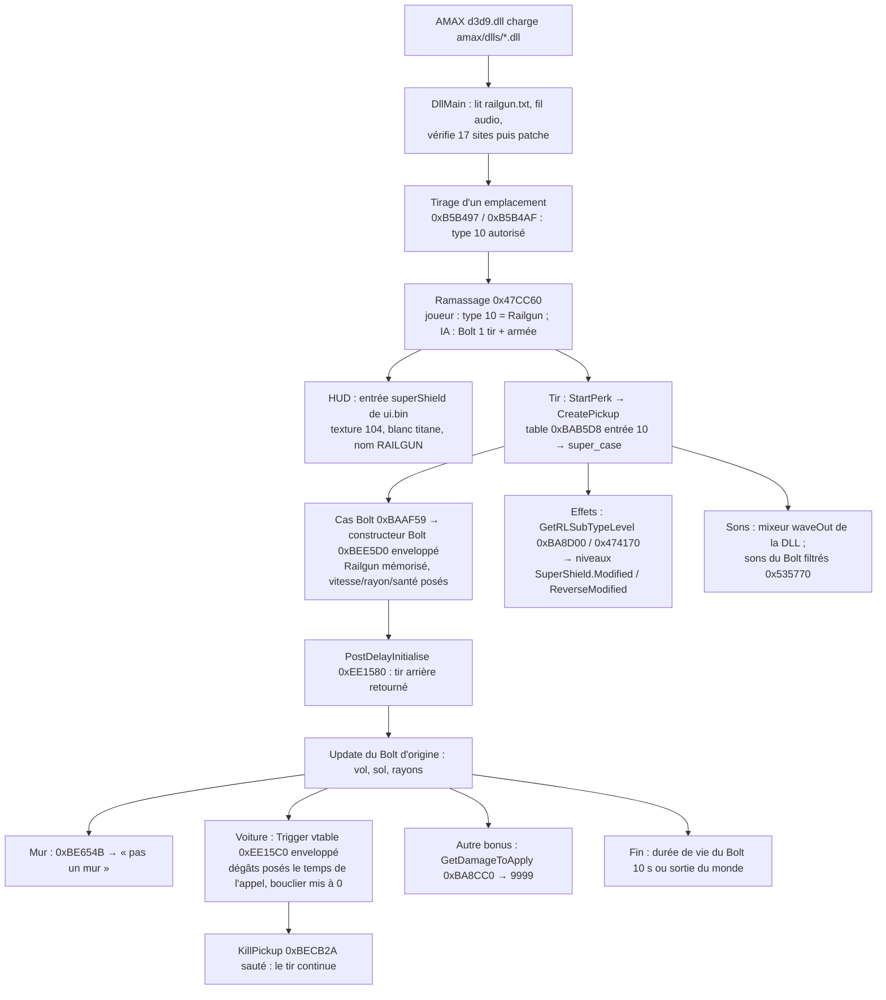
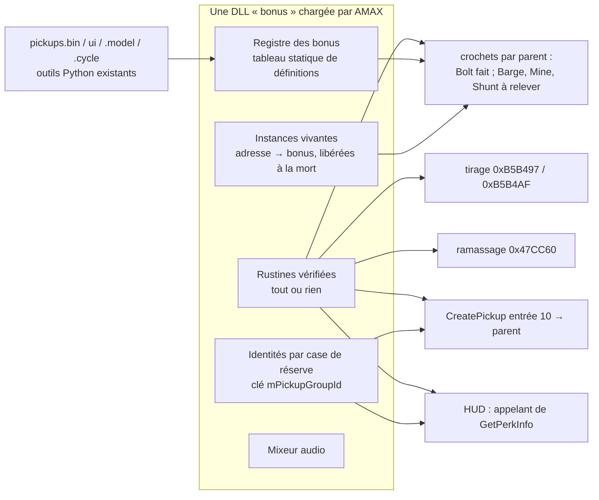

# Architecture d'extension des bonus : audit du Railgun

2026-11-18. **Audit en lecture seule** : aucun fichier du jeu, aucune copie, aucune DLL ni aucun binaire modifiés,
aucun test lancé. Ce document s'appuie sur trois références et ne les répète pas :

- `POWERUPS.md` §14 (méthode « emprunter un type »), §15 (gabarits), §19 (première idée d'hôte de bonus) ;
- `POWERUP_BEHAVIOUR_STUDY.md` (interactions, mods) ;
- `CONNAISSANCES.md`, sections « Bonus Railgun » v1 à v7 (historique détaillé).

## Classification des preuves

| Étiquette | Sens |
|---|---|
| **CONFIRMÉ — CODE** | lu dans le **binaire utilisé** : octets ou désassemblage de `Blur.exe` (voir ci-dessous), ou dans `railgun.c` pour ce que fait la DLL |
| **CONFIRMÉ — DONNÉES** | lu dans les fichiers de données |
| **CONFIRMÉ — GAME** | vu en jeu, ou lu dans le journal `railgun.log` d'une partie réelle |
| **INDICE** | suggéré par la source fuitée ou par une structure, sans preuve dans l'exe |
| **HYPOTHÈSE** | interprétation à vérifier |
| **INCONNU** | non déterminé |

Exécutables étudiés (lecture seule) :

- `Blur.exe` du jeu installé : SHA-1 `dcbd312a…`, l'exe d'AMAX ;
- `Blur_test\Blur.exe` : SHA-1 `cd1d1bdc…`, le même avec un seul octet d'en-tête changé (`LARGE_ADDRESS_AWARE`) ;
- base `0x400000` pour les deux.

La source fuitée (`blur_source\BlurRebuilt\…`) ne prouve rien sur le binaire.

---

## 1. Résumé

- **Le Railgun fonctionne** (CONFIRMÉ — GAME). Dernière partie, v7 :
  - 220 tirs, 106 voitures touchées, 211 murs traversés, 23 boucliers cassés ;
  - aucun plantage ;
  - le tir arrière vole à l'horizontale (journal « moved 101 0 0 m », plus de tir « vers le ciel »).
- **Ce n'est pas un nouveau bonus au sens du moteur.** C'est :
  - le **type 10 (SuperShield coupé)**, qui sert d'identifiant et de case HUD ;
  - qui **crée un Bolt** ;
  - que la DLL **reconnaît et modifie** à 17 endroits du code.

  Aucune classe nouvelle, aucun type nouveau.
- **Réutilisable tout de suite** pour un 2e bonus :
  - le cadre de rustines (vérification octet par octet, tout ou rien, journal) ;
  - l'identification d'une instance par son adresse ;
  - le chargement par AMAX et le réglage par fichier texte ;
  - le mixeur de sons ;
  - les niveaux d'effets à soi dans `pickups.bin` ;
  - le filtrage des sons du jeu ;
  - le tirage sur la piste ;
  - le ramassage par l'IA ;
  - l'option LAN.
- **Spécifique au Railgun** : tout ce qui touche au Bolt (constructeur, `Trigger`, murs, `KillPickup`, retournement
  du tir arrière, dégâts dégressifs).
- **À construire une seule fois** pour en ajouter d'autres :
  1. une **identité de bonus personnalisée** indépendante du type 10 (aujourd'hui, un seul type libre = un seul
     bonus) ;
  2. une **table de bonus** dans la DLL, à la place des variables globales du Railgun ;
  3. un **HUD par bonus** (`GetPerkInfo`) ;
  4. des **crochets génériques par classe parente**, et non plus pour le seul Bolt.
- **Blocages** :
  - le **réseau** : rien n'est synchronisé, la partie doit rester hors ligne ou se jouer entre machines qui ont
    toutes la DLL. Le comportement entre machines n'est pas étudié ;
  - les **types 11 à 15** : le `switch` de création refuse tout type supérieur à 10 (CONFIRMÉ — CODE).

## 2. État réel du prototype (v7)

| Élément | État | Preuve |
|---|---|---|
| Version installée | `Blur_test\amax\dlls\railgun.dll` **identique** à `natif/railgun/railgun.dll` du dépôt (build v7, commit `1ba253c`) | CODE (comparaison de fichiers) |
| Sites patchés | **17 / 17** octets d'origine trouvés dans les deux exes | CODE (vérification hors jeu, cet audit) |
| Chargement | journal : « railgun v7 loaded », 17 × « patched », 6 sons chargés, « own levels found » | GAME |
| Comportement | tirs, voitures traversées, murs, boucliers : compteurs non nuls | GAME |
| Option LAN | « custom race: Railgun ON » au journal | GAME |
| Tir arrière | vole à l'horizontale à 300 m/s (129 relevés) | GAME |
| Tirage filtré | « 0 filtered spawn draw(s) » dans la dernière partie : le chemin filtré n'a pas servi (mode positions fixes, ou Railgun seul) | GAME |
| Réseau, autres joueurs | jamais essayé avec une autre machine qui a la DLL | INCONNU |

Fichiers actuels :

| Fichier | Rôle |
|---|---|
| `natif/railgun/railgun.c` | 954 lignes, toute la DLL |
| `natif/railgun/build.bat` | compilation VS x86 `/MT` |
| `natif/railgun/railgun.txt` | 20 réglages |
| `natif/railgun/railgun.lua` | plugin AMAX, ligne « RAILGUN » dans les options LAN |
| `railgun_install.py` | installation dans `Blur_test` et retrait |
| `railgun_fx.py` | niveaux d'effets à soi, `.cycle` recolorés |
| `b2pickups.py` | Railguns placés sur la carte Marina |

## 3. Architecture technique du Railgun

Parcours étape par étape :

| # | Étape | Mécanisme | Adresse / fichier | Niveau |
|---|---|---|---|---|
| 1 | Chargement | `d3d9.dll` d'AMAX charge chaque `.dll` de `amax\dlls` ; `DllMain` | `railgun.c:930` | CODE + GAME |
| 2 | Initialisation | `load_settings`, fil audio, `apply()` : vérifie **tous** les octets, sinon ne patche rien | `railgun.c:842` | CODE |
| 3 | Identification | **type 10** côté jeu ; côté DLL, l'adresse de l'objet dans `rails[32]` (`rail_of`) | `0xBAB600` (entrée 10 de la table) | CODE |
| 4 | Tirage, ramassage | tirage : `0xB5B497` (exclusion du type 10 levée, probabilité `spawn`), `0xB5B4AF` (filtre 1 octet par emplacement contourné). Ramassage : `0x47CC60` (IA → Bolt à 1 tir et drapeau `armed[]`) | `SetRandomPickupType`, gestionnaire `PickedUp` | CODE + GAME |
| 5 | Réserve et HUD | **rien de la DLL** : le type 10 est déjà géré (1 tir, entrée HUD `superShield`, nom dans `common.loc`) | `ui.bin`, `common.loc` (installateur) | CODE + DONNÉES + GAME |
| 6 | Déclenchement | chemin normal `ActivatePerk` → `StartPerk` → `CreatePickup` | — | INDICE (source) ; GAME (ça tire) |
| 7 | Création | `super_case` : drapeau « prochain Bolt = Railgun », délai écrit dans la structure de création (+0x10), sous-type arrière remis à 0 → cas Bolt. Constructeur du Bolt enveloppé aux 3 appels : vitesse +0x158, rayon +0x150, hauteur +0x154, `FallRate` +0x15C, santé +0xB0, données +0x56C, effets +0x570 | `0xBAAF9F`, `0xBAB083`, `0xBEED50` | CODE |
| 8 | Trajectoire | celle du Bolt (droite, suit le sol) ; arrière : matrice retournée (`pdi_hook`) | vtable `0xEE1580` | CODE + GAME |
| 9 | Collisions | murs : `0xBE654B` répond « pas un mur » ; voitures : `Trigger` ; autres bonus : `GetDamageToApply` = `crush` | `0xBE654B`, `0xEE15C0` / `0xEE1620`, `0xBA8CC0` | CODE + GAME |
| 10 | Effet sur la cible | `Trigger` d'origine (réaction, dégâts) avec `DamageInflicted` remplacé **pendant l'appel** ; puis `mShieldHealth` (+0xC0) = 0 si `mShieldTime` (+0xBC) > 0 | `0xBEC540`, `0xB915D0` | CODE + GAME (boucliers cassés au journal) |
| 11 | Dégâts, réactions | moteur d'origine (Bolt : `SPIN_45`) ; effets d'impact pris dans le niveau Railgun (`vlc_level_thunk`) | `0x474170` | CODE |
| 12 | Réseau | **aucun traitement**. Les autres machines voient un tir de type 10 ; celles qui n'ont pas la DLL suivent l'entrée 10 d'origine (un SuperShield) | — | INCONNU (jamais essayé) |
| 13 | Fin et nettoyage | `KillPickup` sauté sur une voiture ; la fin vient de la durée de vie du Bolt (10 s) ou de la sortie du monde. La case `rails[]` est libérée **seulement** quand la mémoire du pool est réutilisée par un nouveau Bolt (`before_ctor`) | `0xBECB2A` | CODE |

## 4. Inventaire des modifications au jeu

### 4.1 Rustines en mémoire (DLL, 17 sites, vérifiées dans les deux exes)

| Fonction d'origine | Adresse | Modification | Raison | Dépend de | Risque | Réutilisable ? |
|---|---|---|---|---|---|---|
| `SetRandomPickupType` (exclusion des types 8, 9, 10) | `0xB5B497` | CALL | laisser sortir le type 10 sur la piste | registre `ebp` = type | faible | **oui** : tout bonus porté par le type 10 |
| `SetRandomPickupType` (filtre 1 octet `ShuffleTypes`) | `0xB5B4AF` | CALL | les types ≥ 8 ne passent jamais le test d'un octet | `[edi+0x108]` | faible | **oui** |
| `Audio::InterfaceController::SendMessageToSubsystem` | `0x535770` | JMP | retirer les sons du Bolt quand l'objet est un Railgun | identifiants +0x14 | moyen (heuristique : 12 mots du message) | **oui**, avec une table d'identifiants |
| gestionnaire `PickupPickedUp` (`GetNumShotsAwarded`) | `0x47CC60` | CALL | l'IA ne sait pas utiliser le type 10 | `[ecx+0x2C]`, `[edi+0x14]` | faible | **oui** (« type déguisé » pour l'IA) |
| `CreatePickup`, entrée 10 de la table | `0xBAB600` | PTR | brancher le type 10 sur le cas Bolt | table `0xBAB5D8` | faible | **oui** (point d'entrée de création) |
| `CreatePickup`, entrée 3 (Bolt) | `0xBAB5E4` | PTR | un Bolt d'IA « armée » devient un Railgun | `armed[]` | faible | **oui** (même idée pour toute IA déguisée) |
| constructeur du Bolt, 3 appels | `0xBAAF9F`, `0xBAB083`, `0xBEED50` | CALL | reconnaître et régler l'objet créé | champs +0x150…+0x570 | moyen (pool recyclé) | **classe Bolt seulement** |
| vtables Bolt / Bolt arrière : `Trigger` [18] | `0xEE15C0`, `0xEE1620` | PTR | dégâts et bouclier propres au Railgun | `0xBEC540` | moyen (données partagées modifiées pendant l'appel) | **classe Bolt seulement** ; le principe vaut pour les autres projectiles |
| `Trigger` : appel de `KillPickup` | `0xBECB2A` | CALL | traverser les voitures | `0xBA6AC0` | faible | Bolt seulement |
| `CheckCollisions` : test de mur (rayon fin) | `0xBE654B` | CALL | traverser les murs | `0xBE4D10` | faible | **tous les projectiles** (`C_PickupProjectile` : Shunt, Bolt, Mine lancée) |
| `C_PickupBase::GetDamageToApply` | `0xBA8CC0` | JMP | écraser les autres bonus | `0x1133220` | faible | **toutes les classes** (méthode de base) |
| `C_PickupBase::GetRLSubTypeLevel` | `0xBA8D00` | JMP | effets à soi (charge, éclair) | niveaux du type 10 | faible | **toutes les classes** |
| `C_VehicleComponent_Pickups::GetRLSubTypeLevel` | `0x474170` | JMP | effets d'impact à soi | drapeau `in_trigger` | moyen (drapeau global) | oui, à généraliser |
| vtable Bolt : `PostDelayInitialise` [2] | `0xEE1580` | PTR | tir arrière retourné et décalé | — | faible | Bolt seulement |

### 4.2 Données

`railgun_install.py` et `railgun_fx.py`, appliqués à `Blur_test` seulement :

| Fichier | Changement | Réutilisable ? |
|---|---|---|
| `pickups.bin` | 16 enregistrements ajoutés (hashes ≥ `0xFFFF2001`) ; seuls `SuperShield.Modified` / `ReverseModified` modifiés | **oui** : la méthode de clonage (`railgun_fx.Edit`). Places libres sur le type 10 : DoubleTap +0x14, Reversed +0x1C, ReversedDoubleTap +0x24, Mini +0x2C (décalages : CODE ; occupation dans le fichier : INDICE) |
| `dynamiceffects.bin` | 3 enregistrements (traînées) | oui |
| `ui.bin` | couleurs de l'entrée `superShield` (chaîne de même longueur) | **une seule entrée HUD** pour le type 10 |
| `loc/common.loc` | « RAILGUN » à la place de « SUPER SHIELD » | une seule chaîne |
| `animations/perks/railgun_*.cycle` | copies recolorées | oui |
| sons `.wav` dans `amax\dlls` | lus par la DLL | oui |
| plugin `amax\plugins\railgun\railgun.lua` | ligne n° 12 dans les options LAN | oui, mais une seule place libre (4e de la colonne de droite) |

### 4.3 Fichier exécutable sur disque

Aucun changement de code. `Blur_test\Blur.exe` n'a que l'octet `LARGE_ADDRESS_AWARE` (fait pour les cartes, pas pour
le Railgun) (CODE).

## 5. Problèmes connus

État vérifié dans le code v7 et dans le dernier journal.

| Problème | Catégorie | Origine probable | Cause démontrée ? | Conséquence | Solution envisagée |
|---|---|---|---|---|---|
| Jamais essayé en réseau ; les autres machines ne savent pas ce qu'est un Railgun | synchronisation | aucune donnée envoyée ; un Bolt est jugé par le tireur, et sa victime applique ses propres dégâts | oui (CODE : rien dans la DLL) ; effet réel INCONNU | dégâts et effets différents selon la machine ; possible désynchronisation | même DLL partout, puis étude de `JudgedPowerupHit` (§10) |
| Une seule identité : le type 10 | limite du moteur | le `switch` s'arrête à 10 (`cmp eax,0Ah ; ja`) | oui (CODE `0xBAADB0`) | un 2e bonus ne peut pas prendre le type 10 en même temps | identité personnalisée (§9.1) |
| Cases `rails[32]` libérées seulement au recyclage du pool | Railgun | pas de crochet sur la mort de l'objet | oui (CODE `before_ctor`) | en course longue avec beaucoup de Railguns et peu de Bolts, « more than 32 alive » → Bolt ordinaire ; jamais vu au journal | crochet de destruction (`KillPickup` / libération du pool) |
| Dégâts posés en modifiant les données **partagées** du Bolt pendant `Trigger` | Railgun | pas de champ de dégâts par objet | oui (CODE) ; fonctionne (GAME) | non réentrant ; faux si les dégâts étaient calculés plus tard (réseau) | crochet sur le calcul des dégâts (`CheckPowerUpDamageModifiers`, adresse INCONNUE) |
| Bouclier cassé par écriture directe de `mShieldHealth` | Railgun | — | oui (CODE) | marche seulement sur la machine qui juge le coup | passer par le chemin de dégâts du bouclier |
| Tout dépend d'un seul joueur local (`is_human` = l'index du joueur 0) | Railgun | lecture d'une chaîne de pointeurs fixe | oui (CODE) | écran partagé : le 2e joueur est traité comme une IA (il reçoit un Bolt) | HYPOTHÈSE : à tester en écran partagé |
| `spawn_roll` utilise `rand()` local | réseau | — | oui (CODE) | tirages différents sur chaque machine si chacune tire ses emplacements | n'agir que sur la machine qui décide (hôte en positions fixes) |
| Baisse de volume (`waveOutSetVolume`) appliquée à toute l'application | ressources | Windows : volume par application | oui (CODE + notes v4) | assumé : imite l'étouffement du Shunt | moteur audio du jeu (`.baf`), pas encore d'écrivain |
| Couleurs des modèles et étoile sur la piste | ressources | modèles gris colorés par `.cycle` ; modèle `ShieldSuperPickup` | partiellement traité (copies `.cycle`) | visuel incomplet | méthode du bonus posé sur la piste (`ESSAI_HUD_SHIELD_PICKUP.md`) |
| Tir arrière au rétroviseur | ressources | l'orbe arrière n'exclut pas le rétroviseur | non | à confirmer | test |
| Overbolt (Shannon) et Railgun | compatibilité | le Railgun est un Bolt à 1 tir donné à l'IA | HYPOTHÈSE | l'IA de Shannon reçoit `GetNumShotsAwarded` court-circuité à 1 | test |
| Adresses fixes de l'exe d'AMAX | compatibilité | — | oui (CODE ; garde-fou : rien n'est patché sinon) | BlurRebuilt ou un autre exe : DLL inactive | — |

**Cosmétique** : couleurs, étoile, rétroviseur, volume.

**À régler avant d'en ajouter d'autres** :

- l'identité unique ;
- la libération des cases `rails[]` ;
- les dégâts par objet ;
- le comportement en réseau, au moins le décrire.

## 6. Mécanismes réutilisables

Démontré = le mécanisme ne dépend pas du Bolt (raisonnement sur le code de la DLL) ; essayé seulement avec le
Railgun.

### A. Infrastructure commune

| Élément | Où | Pourquoi réutilisable | Niveau |
|---|---|---|---|
| Rustines vérifiées octet par octet, tout ou rien, journal | `apply()`, table `patches[]` | indépendant du bonus | CODE + GAME |
| Chargement par AMAX (`amax\dlls`) et réglages texte | `DllMain`, `load_settings` | idem | GAME |
| Identification d'une instance par adresse + recyclage du pool | `rails[]`, `before_ctor` | toute classe allouée en pool (`DynamicPool`) | CODE ; un seul cas essayé |
| Entrée de création (table `0xBAB5D8`) | `super_case` | le type 10 peut mener à **n'importe quel** cas parent (Bolt, Shunt, Mine…) | CODE |
| Délai de tir par bonus (structure de création +0x10) | `super_setup` | même structure pour tous les types | CODE + GAME |
| Tirage sur la piste du type 10 | `0xB5B497`, `0xB5B4AF` | indépendant du comportement | CODE + GAME |
| IA « déguisée » (type 0-7 à la place, armée, convertie au tir) | `0x47CC60`, `0xBAB5E4` | même idée pour tout parent connu de l'IA | CODE ; Bolt seulement essayé |
| Effets à soi (niveaux de `pickups.bin` par `GetRLSubTypeLevel`) | `0xBA8D00`, `0x474170`, `railgun_fx.py` | méthodes de **base**, valables pour toutes les classes | CODE + GAME |
| Filtrage des sons du jeu par identifiant | `0x535770` | messages audio de tous les bonus | CODE + GAME |
| Mixeur de sons de la DLL (voix, distance, gauche / droite, boucles qui suivent un objet) | fil `audio` | lit seulement une position (+0x80 de `C_PickupBase`) | CODE + GAME |
| Option LAN par plugin Lua + export de la DLL | `railgun.lua`, `railgun_on/off/only` | une ligne par bonus, mais une seule place libre visible | GAME |
| HUD et nom | `ui.bin` `superShield`, `common.loc` | **une seule entrée** (type 10) | DONNÉES + GAME |

### B. Réutilisable selon le type de bonus

| Mécanisme | Bonus concernés | Niveau |
|---|---|---|
| Test de mur ignoré (`0xBE654B`) | tous les `C_PickupProjectile` (Bolt, Shunt, Mine lancée) | CODE (méthode commune) ; Bolt seulement essayé |
| `GetDamageToApply` (contre les autres bonus) | toutes les classes | CODE |
| Dégâts sur la voiture posés pendant le coup | toute classe dont le coup passe par `RegisterHit` dans le même appel | HYPOTHÈSE hors Bolt |
| Bouclier cassé (`+0xBC` / `+0xC0` de l'acteur logique) | tout effet | CODE + GAME |
| Réglage des champs d'un objet après construction | uniquement si on connaît les champs de la classe (connus : Bolt) | CODE pour le Bolt |
| Matrice de départ modifiée (`PostDelayInitialise`) | projectiles | CODE pour le Bolt |
| Force sur une voiture | `b2gravity.dll` écrit une **force externe** sur la voiture (+0x1468, couple +0x1474) | CODE + GAME (autre projet) |
| Recherche de voitures et positions | liste des véhicules (`vehicle_pos` : `+0x68 + i×0x10`, position +0x130) | CODE + GAME (sons) |

### C. Spécifique au Railgun

- Traversée des voitures (`KillPickup` sauté) et des murs.
- Dégâts dégressifs, `crush`.
- Vitesses 600 / 300, rayon 0,8.
- Retournement et décalage du tir arrière.
- Bouclier toujours cassé.
- Sons et réglages du mixeur (étouffement).

## 7. Architecture d'origine utile à l'extension (rappels vérifiés)

| Point | Fait | Niveau |
|---|---|---|
| Types connus de l'exe | 0 à 10 ; `CreatePickup` : `cmp eax,0Ah ; ja 0xBAB5CC` (pas d'objet au-delà) | CODE (`0xBAADB0`) |
| Cases sans objet | 6 (Repair), 8 (Fan), 9 (Stopwatch) → `0xBAB5CB` | CODE (table) |
| Réserve | `PickupStore` = type, nombre de tirs, munitions infinies, `mPickupGroupId`, distance. **Pas de sous-type** : il est choisi au tir | INDICE (source) |
| HUD | `GetPerkInfo(type, nbTirs, modBolt)` : `switch` sur le type, NULL pour 8 et 9 | CODE (`0xC55320`, `POWERUPS_HUD.md` §8) |
| Réseau | `PickupFired` : type et sous-type sur 4 + 4 bits, délai ×100 sur 1 octet (≤ 2,55 s), valeurs optionnelles | INDICE (source) |
| Données | `GetPickupType(enum)` rend le **premier** `PickupType` de ce type | CODE (`0x4811A0`) + DONNÉES |
| IA | `cPerkSkillUsage` ne connaît que 0 à 7 | INDICE (source) ; confirmé par le besoin de déguiser l'IA (GAME) |
| Tirage | `ShuffleTypes` sur 1 octet | CODE (`0xB5B4B8`) |
| Impulsions sur les voitures | `ApplyImpulseWorldSpace` / `LocalSpace` existent dans le code vivant (SuperShield, FakePhysics) | INDICE (source) ; adresses dans l'exe INCONNUES |
| Fausse physique | réactions scriptées et freinage forcé, dépendants du FPS sur PC | INDICE (`POWERUP_BEHAVIOUR_STUDY.md` §7.4) |

## 8. Prototypes coupés (intérêt architectural seulement)

Ce ne sont **pas** des bonus du jeu. Les classes existent dans la source, mais aucune n'est compilée dans l'exe : leurs
chaînes de réglage (`Perks.BlackHole.Radius`, `Perks.Bombard.Radius`, `Perks.Jump.UpForceModifier`,
`Perks.Magnet.FiringHeight`, `Perks.Trap.Width`, `Perks.Pulse.ScaleCutOff`, `Perks.BullBar.MaxForce`) sont
**absentes** de `Blur.exe`, alors que celles des classes vivantes (`Perks.BlindfireShotgun.Angle`,
`Perks.DoubleShield.Mass`, `Perks.MasterMineBomb.ForcePrime`) y sont (CODE).

Points communs :

- elles appartiennent à un **ancien système** : paire `C_PickupFireX` / `C_PickupHitX`, `mLevels[]`, types
  `E_PICKUP_TYPE_TELEPORT`, `_MAGNET`… absents de l'énumération actuelle, `Update(bool multijoueur)` ;
- elles poussent les voitures par **vraies impulsions** (`ApplyImpulseLocalSpace`).

| Classe | Fichier | Logique | Intérêt |
|---|---|---|---|
| BlackHole | `Misc/PickupBlackHole.cpp` (316 l.) | attire les voitures dans un rayon (`Radius`, `Strength`), puis explose | zone d'attraction : impulsion radiale |
| Bombard | `Misc/PickupBombard.cpp` (444 l.) | frappe de zone, seuil de masse | zone + filtre par masse |
| Jump | `Misc/PickupJump.cpp` (102 l.) | impulsion verticale sur soi | effet sur soi par impulsion |
| Magnet | `Misc/PickupMagnet.cpp` (419 l.) | projectile qui tire la cible, test d'obstacles | projectile + force continue |
| Teleport | `Misc/PickupTeleport.cpp` (98 l.) | déplacement de la voiture | position imposée : pas de mécanisme vivant équivalent connu |
| Trap | `Misc/PickupTrap.cpp` (331 l.) | boîte laser posée, déclenchée au passage | objet posé avec volume de déclenchement |
| Ghost | `Upgraded/PickupGhost.cpp` (101 l.) | voiture fantôme | rappel : `mGhosted` existe dans l'acteur logique (INDICE) |
| Grab | `Upgraded/PickupGrab.cpp` (316 l.) | vole un bonus (référence Bomb et Flash) | vol de réserve |
| Pulse | `Upgraded/PickupPulse.cpp` (196 l.) | onde dont l'effet baisse avec la distance | zone à dégâts dégressifs |
| Rift | `Upgraded/PickupRift.cpp` (196 l.) | « BullBar » : forces min / max, déplace les mines | ancêtre probable de la faille du Nitro (`RiftMin/MaxForce` existent dans les données) |

Conclusion : **aucune** n'est réutilisable telle quelle. Ce sont des **modèles d'algorithmes** à réécrire dans la DLL
sur un parent vivant (Barge pour une zone, Mine pour un objet posé, Bolt ou Shunt pour un projectile). Les impulsions
réelles exigent de trouver les fonctions de corps physique dans l'exe ; `b2gravity` a déjà trouvé un chemin de force
(§6 B).

Interactions des bonus avec le décor (forces, objets, réseau) : voir `POWERUP_ENVIRONMENT_INTERACTIONS.md`.

## 9. Possibilités d'extension

### 9.1 Identifiants : où loger un 2e, un 3e… bonus

| Piste | Comment | Coût | Limites | Niveau |
|---|---|---|---|---|
| a) **Plusieurs bonus derrière le type 10** | le type 10 reste le porteur ; la DLL garde **quel** bonus est dans chaque case de la réserve (table par voiture, clé `mPickupGroupId`, unique par ramassage) | moyen : crochets au ramassage, au tir (lire la case utilisée), au HUD | HUD : `GetPerkInfo` reçoit le type et le nombre de tirs, **pas** la case → il faut envelopper l'appelant (`UIPerks2::Render`, `0xC58130`) ou coder l'identité dans `mNumShots` (risqué) | CODE pour les fonctions ; méthode : HYPOTHÈSE |
| b) **Sous-types libres d'un type existant** | choisir le sous-type au tir (`StartPerk`) et rediriger le `switch` interne de `CreatePickup` | moyen | la réserve et le HUD voient le type parent (même icône, même nom) | INDICE |
| c) **Types 11 à 15** | agrandir la table de `CreatePickup`, `GetPerkInfo`, les tableaux indexés par type (`mLivePickups[type]`, audio, IA), l'énumération XT de `pickups.bin` | très élevé : dépassements de tableaux invisibles | — | CODE (borne à 10) ; reste INCONNU |
| d) **Recompilation** (source BlurRebuilt) | vrais types et classes en C++ | élevé ; **autre exe** que celui d'AMAX | compatibilité AMAX et réseau INCONNUE | INDICE |

**Recommandation : a)**. Elle réutilise tout ce qui marche pour le Railgun (tirage, HUD de base, 1 tir, IA déguisée)
et repousse le problème des tableaux indexés par type.

### 9.2 Création

- **Intercepter la création** : déjà fait par la table (entrée 10) puis le cas parent.
- **Classe à soi** : HYPOTHÈSE. Allouer un objet de la DLL et l'insérer dans les listes du gestionnaire demande de
  connaître `mLivePickups`, les pools et la destruction (`Delete`, pools `Free`), dont aucune adresse n'est vérifiée.
  Plus sûr : **réutiliser la classe parente** et changer son comportement par ses méthodes virtuelles (comme le
  `Trigger` du Bolt).
- Vtables connues : Bolt `0xEE1578`, Bolt arrière `0xEE15D8` (24 entrées). Celles du Shunt, de la Mine et de la Barge
  ne sont **pas** relevées.

### 9.3 Réserve

| Cas | Comportement | Niveau |
|---|---|---|
| Réserve de 3 | `NumPickupSlots` | INDICE + COMM |
| Réserve pleine | le bonus est refusé, pas remplacé | INDICE |
| Munitions | type 10 = 1 tir (`GetNumShotsAwarded`) ; un bonus à plusieurs tirs demande un crochet là | CODE (`0x4699F0`) |
| Wreck | aucun vidage trouvé dans la source | INCONNU |
| Déconnexion | INCONNU | — |

### 9.4 Gameplay

| Besoin | Parent | État |
|---|---|---|
| Projectile | Bolt (maîtrisé), Shunt (guidage `.aid`), Mine lancée | Bolt : CODE + GAME ; autres : vtables à relever |
| Effet instantané sur soi | Repair / Nitro (sans objet ou avec effet) | crochet de `StartPerk` (adresse INCONNUE) |
| Zone autour de soi | Barge (ellipse, plusieurs voitures) | INDICE |
| Objet posé, durée longue | Mine (60 s, collision intérieure / extérieure) | INDICE |
| Zone à distance | Shock (placement par l'hôte) | INDICE ; réseau compliqué |
| Effet sur une voiture | réaction `FakePhysics` (par le coup), bouclier (+0xBC/+0xC0), force externe (`b2gravity`) | CODE |
| Dégâts personnalisés | méthode Railgun (pendant l'appel) ou crochet de `CheckPowerUpDamageModifiers` | CODE (Railgun) ; INCONNU (crochet) |

### 9.5 Ressources

| Ressource | Données seules | DLL | Exe |
|---|---|---|---|
| `pickups.bin` (réglages, niveaux d'effets) | **oui** (`railgun_fx.Edit`) | pour rattacher le niveau à l'objet | — |
| `dynamiceffects.bin` (particules) | **oui** | — | — |
| `ui.bin` (entrée HUD du type 10, planches 100-109) | **oui** (1 entrée par type ; atlas élargi : `ESSAI_HUD_SUPPORT_ATLAS.md`) | pour plusieurs icônes derrière un type | — |
| `ui_common.bpr` (icônes) | **oui** (validé en jeu) | — | — |
| `audioentities.bin`, `pickups.baf` | lecture seule aujourd'hui (pas d'écrivain de `.baf`) | sons par la DLL (mixeur) | — |
| `.model`, `.cycle` | **oui** (textures intégrées, couleurs `.cycle` : validé en jeu) | — | — |
| `common.loc` (nom) | **oui** (1 chaîne par type) | plusieurs noms : INCONNU | — |

## 10. Contraintes réseau

- **Le Railgun n'a jamais été essayé en réseau.**
- Ce que dit l'analyse (`POWERUPS.md` §13) :
  - un Bolt est **jugé par le tireur** (`JudgedPowerupHit`) ;
  - le type et le sous-type partent sur 4 bits ;
  - le délai part sur 1 octet ;
  - les autres machines recréent le projectile **localement**.
- **Machine sans la DLL** : l'entrée 10 d'origine crée un SuperShield, pas un Bolt → objets différents (INDICE).
- **Avec la DLL partout** : chaque machine crée un Railgun. Mais :
  - les dégâts, le bouclier cassé et les traversées sont appliqués **par chaque machine** sur ses copies ;
  - le coup décidé par le tireur arrive chez la victime par le chemin d'origine du Bolt, avec ses dégâts à elle :
    INCONNU ;
  - `rand()` du tirage est local.
- Sans étude du réseau, **règle : hors ligne, ou LAN entre machines identiques, à titre d'essai**. Jamais sur les
  serveurs publics AMAX : AMAX garde le jeu de 2010 (`POWERUP_BEHAVIOUR_STUDY.md` §6).
- **Piste à étudier** : faire porter l'identité du bonus par le sous-type (4 bits) ou par les valeurs optionnelles de
  `PickupFired`, pour que chaque machine sache quel bonus personnalisé recréer (INDICE).

## 11. Matrice de faisabilité

Légende :

| Code | Sens |
|---|---|
| ✓ | possible par cette couche |
| — | sans objet |
| ? | inconnu |

| Fonctionnalité | Données | DLL (rustines en mémoire) | Exe (recompilation ou rustine sur disque) | Preuves | Difficulté |
|---|---|---|---|---|---|
| Icône | ✓ (`ui_common.bpr`, cases 100-109) | ✓ pour plusieurs icônes derrière un type | — | GAME (atlas 105-109, case 104) | **Facile** |
| Modèle sur la piste | ✓ (textures du `.model`) ; un modèle par **type** | ✓ pour plusieurs bonus derrière un type | — | GAME (bouclier posé) | **Facile** (un bonus), **Moyen** (plusieurs) |
| Nouveau bonus (identité) | — | ✓ derrière le type 10 (1 bonus) ; plusieurs : table d'identités | ✓ types 11-15 | CODE (borne 10) | **Moyen** (DLL) / **Très difficile** (types 11-15) |
| Nouvelle classe | — | ? (insertion dans les listes du gestionnaire) | ✓ (recompilation) | INCONNU | **Très difficile** |
| Projectile inédit (comportement) | — | ✓ en modifiant Bolt / Shunt | — | CODE + GAME (Bolt) | **Moyen** (Bolt), **Difficile** (autres vtables) |
| Zone d'effet | — | ✓ sur la Barge | — | INDICE | **Moyen** |
| Effet persistant (objet posé) | — | ✓ sur la Mine | — | INDICE | **Difficile** (durée, collisions, IA) |
| Effet sur un véhicule | réactions existantes par les données du parent | ✓ (bouclier, force externe, réaction) | — | CODE + GAME | **Moyen** |
| Dégâts personnalisés | ✓ (`DamageInflicted` du parent) | ✓ par objet (méthode Railgun) | — | GAME | **Facile** |
| Nouvelle interaction entre bonus | — | ✓ (`GetDamageToApply`, collisions de projectiles) | — | CODE + GAME | **Moyen** |
| Nouveau comportement réseau | — | ? | ? | INCONNU | **Bloquant** aujourd'hui |
| Logique d'IA | `air.bin` (profils du parent) | ✓ déguisement (type 0-7) | ✓ nouvel évaluateur (recompilation) | GAME (IA armées) | **Facile** (déguisement), **Très difficile** (vraie IA) |
| Son | — (pas d'écrivain `.baf`) | ✓ mixeur de la DLL | — | GAME | **Facile** |
| Option LAN | — | ✓ plugin + export | — | GAME | **Facile** (1 ligne), **Moyen** (plusieurs) |

Justification des classements :

- **facile** = déjà fait pour le Railgun ;
- **moyen** = même méthode sur un autre parent ou en plusieurs exemplaires ;
- **difficile** = vtables et champs d'une autre classe à relever ;
- **très difficile** = structures internes inconnues (listes du gestionnaire, tableaux indexés par type) ;
- **bloquant** = le réseau, sans étude ni moyen d'essai entre machines.

## 12. Architecture cible

Elle reste dans la suite de `railgun.dll`, sans cadre abstrait.

| # | Composant | Existe dans le moteur ? | Réutiliser | Intercepter | DLL | Exe | Dépend de | Risque |
|---|---|---|---|---|---|---|---|---|
| 1 | Identification | type 10 seulement | type 10 comme porteur | ramassage, tir | **table d'identités** | — | `mPickupGroupId` (INDICE) | moyen |
| 2 | Création | `CreatePickup` + classes parentes | oui | entrée 10 (fait) | aiguillage vers le parent du bonus | — | table `0xBAB5D8` | faible |
| 3 | Cycle de vie | `Update`, `KillPickup`, pools | oui | **mort de l'objet** (à ajouter) | registre des instances | — | `0xBA6AC0` | moyen |
| 4 | Réserve | `PickupStore`, `GetNumShotsAwarded` | oui | nombre de tirs par bonus | oui | — | `0x4699F0` | faible |
| 5 | Déclenchement | `StartPerk` | oui | via la création (fait) | délai par bonus (fait) | — | structure +0x10 | faible |
| 6 | Projectiles et objets | classes Bolt, Shunt, Mine, Barge | oui | méthodes virtuelles par parent | oui | — | vtables à relever (sauf Bolt) | moyen à élevé |
| 7 | Collisions, cibles | rayons des projectiles, `Trigger`, ellipse de la Barge, corps des Mines | oui | test de mur (fait), `Trigger` (Bolt fait) | oui | — | — | moyen |
| 8 | Dégâts, effets temporaires | `RegisterHit`, réactions, bouclier | oui | dégâts pendant l'appel (fait) ; crochet propre plus tard | oui | — | `CheckPowerUpDamageModifiers` (INCONNUE) | moyen |
| 9 | Réseau | `PickupFired`, coups jugés | oui | **à étudier** | ? | ? | — | **bloquant** |
| 10 | HUD | `GetPerkInfo`, `ui.bin` | entrée du type 10 | appelant de `GetPerkInfo` pour plusieurs icônes | oui | — | `0xC55320`, `0xC58130` | moyen |
| 11 | Ressources | `pickups.bin`, `.model`, `.cycle`, `ui_common.bpr` | **oui** (outils du dépôt) | `GetRLSubTypeLevel` (fait) | oui | — | niveaux libres du type 10 | faible |
| 12 | Nettoyage | `KillAllPickups` en fin de course | oui | mort de l'objet | registre | — | — | moyen |

**Concret, sans abstraction gratuite** :

- un tableau statique `{ nom, parent, réglages, niveau d'effets, sons, type IA, probabilité }` ;
- un aiguillage par parent ;
- les rustines déjà écrites, regroupées par parent.

Pas de greffons ni de chargement dynamique de bonus tant qu'il n'y en a que deux ou trois.

## 13. Plan de développement (à ne pas commencer sans accord)

**Étape 1 — Stabiliser le Railgun.**

- Indispensable :
  - libérer les cases `rails[]` à la mort de l'objet ;
  - décrire, sans le corriger encore, ce qui se passe en LAN entre deux machines avec la DLL (test T-R3) ;
  - vérifier l'écran partagé (`is_human`).
- Cosmétique : couleurs, étoile, rétroviseur.

**Étape 2 — Infrastructure commune.** Sortir du code Railgun :

- la table de rustines ;
- le registre d'instances, avec mort de l'objet ;
- la table d'identités par case ;
- l'aiguillage de l'entrée 10 vers un parent choisi par bonus ;
- le mixeur.

Points d'injection : ceux du §4.1 marqués « oui », plus deux à trouver : la mort de l'objet et l'appelant de
`GetPerkInfo`.

**Étape 3 — Validation technique.** Le Railgun refait sur l'infrastructure doit donner **le même journal** que la v7
(référence). Puis un test par composant :

- identité : 2 bonus différents dans la réserve en même temps ;
- HUD : 2 icônes différentes ;
- IA déguisée sur un 2e parent ;
- nettoyage : plus de 32 objets dans une course.

**Étape 4 — Premier bonus supplémentaire.**

- **Candidat : une onde sur la base de la Barge** (zone autour de soi, effet sur plusieurs voitures, jugée par le
  tireur comme le Bolt). Exemple : une onde qui bloque la réserve ou casse les boucliers.
- Pourquoi :
  - un parent **différent** du Bolt (valide l'aiguillage et des crochets d'une 2e classe) ;
  - **pas de projectile** (valide un bonus sans trajectoire) ;
  - l'IA sait déjà utiliser la Barge (type 4) ;
  - plusieurs voitures touchées (défis « Hit 5 cars with a single Barge »).
- Ce qu'il valide en plus du Railgun :
  - **deux bonus personnalisés en même temps** (identité, HUD, sons) ;
  - un 2e jeu de crochets par parent.
- Difficulté : **moyenne**. Il faut relever la vtable et l'ellipse de la Barge (`PickupBarge.cpp:170-206`) dans
  l'exe.
- Candidat suivant : un objet posé sur la base de la Mine (style Icewall), plus difficile (durée, collisions, IA qui
  évite).

**Étape 5 — Extension.** Ajouter un bonus doit se résumer à :

- une ligne dans le registre ;
- un niveau d'effets (outil Python) ;
- au besoin, une fonction de comportement.

On ne crée de nouveaux crochets que pour un **nouveau parent**. Le réseau reste à part.

## 14. Questions résolues (2026-11-19, lecture seule)

1. **Mort d'un objet (libération du pool)** : **`0xBA9D00`** (`C_PickupsManager::Delete(C_PickupBase* pPickup)`, CONFIRMÉ — CODE).
   - Calling convention `__thiscall` (`ecx = C_PickupsManager*`, `[esp + 4] = pPickup`).
   - Lit `mClassType = [pPickup + 4]`, borne à `0x13` (19 classes), table de saut à `0xBA9EA4`.
   - Chaque cas prend le pool dans `mpPickupPools = [ecx + 0xA70]` et appelle sa méthode `Free` (ex. BlindfireProjectile à `0xBA9D83`, Barge à `0xBA9DD7`).
   - **Point d'accroche direct** : hooker `0xBA9D00` permet à la DLL d'être notifiée instantanément de la destruction de n'importe quel pickup et de libérer son slot dans `rails[32]` ou le registre d'instances.

2. **HUD et identité par case** : **`0xC59293`** dans `UIPerks2::Render` (CONFIRMÉ — CODE).
   - À `0xC59273`-`0xC59287`, `esi` est `UIPerks2*`, `[esi + 0x1D8]` est `m_pPickupInfo` (`VehiclePickupInfo*`), `[edx + 0x10]` est le tableau `mPickupStore`.
   - À `0xC59287`, `add eax, ecx` calcule l'adresse exacte de la case `&m_pPickupInfo->mPickupStore[i]`.
   - Dans `PickupStore` (24 octets) : `+0x00` type (10), `+0x08` nombre de tirs, et **`+0x10` est `mPickupGroupId`** !
   - À `0xC59293`, l'appel `call 0xC554C0` (`UIPerks2::GetPerkInfo`) est exécuté.
   - **Point d'accroche direct** : en remplaçant ce call par une fonction hook, la DLL lit `[eax + 0x10]` (`mPickupGroupId`) et retourne le `C_UIPerkInfo` propre à ce bonus personnalisé, résolvant complètement le problème d'icône et de couleur distinctes par case.

3. **VTable et fonctions de la Barge (`C_PickupBarge`)** (CONFIRMÉ — CODE) :
   - VTable : **`0xEE0D58`** (18 méthodes virtuelles).
   - Constructeur : **`0xBE9230`** (appelé lors de `CreatePickup` à `0xBAB0BE` pour le type 4).
   - `Update` (boucle par image) : **`0xBE8360`** (entrée 6 de la vtable).
   - `IsInsideEllipse` : **`0xBE6FB0`** (test de zone elliptique, 3 appels dans `Update`).
   - `CheckDynamicObjects` (décor) : **`0xBE6970`** (au plus 3 objets).
   - Champs majeurs : `[barge + 0x144]` `mpBargeData`, `[barge + 0x148]` `mSizeMultiplier`, `[barge + 0x14C]` `mMajorRadius`, `[barge + 0x150]` `mMinorRadius`, `[barge + 0x154]` `mTimer`, `[barge + 0x158]` `mFixedPosition`.

## 15. Questions encore ouvertes

1. Vtables et champs de la Mine et du Shunt dans l'exe.
2. Fonctions d'impulsion sur les corps de voiture dans l'exe.
3. Comportement en LAN de deux machines avec la DLL (identité, dégâts, bouclier, tirages).
4. Écran partagé et Railgun.
5. Occupation réelle des poignées libres du type 10 dans `pickups.bin` (DoubleTap, Reversed, ReversedDoubleTap,
   Mini).
6. BlurRebuilt : compile-t-il un exe compatible avec AMAX ?

**Tests en jeu à prévoir** (proposés, non lancés) :

| # | But | Protocole court |
|---|---|---|
| T-R1 | écran partagé | deux joueurs, Railgun ON, le joueur 2 ramasse un Railgun : Railgun ou Bolt ? |
| T-R2 | nettoyage | course longue avec Railgun seul : « more than 32 » au journal ? |
| T-R3 | LAN | 2 machines avec la même DLL : chacun tire sur l'autre ; noter les dégâts, le bouclier, ce que voit l'autre |
| T-R4 | Overbolt et Railgun | carrière, Shannon armée d'un Railgun : nombre de tirs |

## 16. Sources techniques

- `natif/railgun/railgun.c` (v7, commit `1ba253c`), `railgun.txt`, `railgun.lua`, `build.bat`, `railgun_install.py`,
  `railgun_fx.py`, `b2pickups.py`.
- `Blur_test\amax\dlls\railgun.log` (dernière partie, 2026-11-17).
- Désassemblage capstone (cet audit) :
  - `CreatePickup` `0xBAADB0` à `0xBAADBA`, table `0xBAB5D8` ;
  - tirage `0xB5B492` à `0xB5B4C4` ;
  - présence des chaînes de réglage dans `Blur.exe`.
- Source fuitée :
  - `PickupsManager.cpp`, `PickupClasses.h`, `VehiclePickupInfo.h` ;
  - `Misc/*` et `Upgraded/*` (prototypes) ;
  - `PickupSuperShield.cpp` (impulsions).
- Documents : `POWERUPS.md` §13 à §15, §19 ; `POWERUPS_HUD.md` §8 ; `POWERUP_BEHAVIOUR_STUDY.md` ;
  `CONNAISSANCES.md` (Railgun v1 à v7, gravité `b2gravity`).

## 16. Réponse à la question du mini-projet

> Si nous voulions ajouter demain un deuxième bonus inédit, que pourrions-nous réutiliser immédiatement, et que
> faudrait-il encore développer ?

**Réutilisable immédiatement** :

- le cadre de rustines vérifiées ;
- le chargement par AMAX et les réglages en texte ;
- les rustines de tirage, de ramassage par l'IA et d'entrée de création du type 10 ;
- le délai par bonus ;
- les niveaux d'effets et les outils Python (effets, `.cycle`, icônes, modèle sur la piste) ;
- le filtrage des sons du jeu et le mixeur ;
- les crochets de base valables pour toutes les classes (`GetDamageToApply`, `GetRLSubTypeLevel`, test de mur des
  projectiles) ;
- l'écriture du bouclier ;
- le plugin LAN.

**Si ce 2e bonus est aussi un projectile de type Bolt** : presque tout, mais **à la place** du Railgun, pas à côté.

**À développer** :

1. une **identité** pour plusieurs bonus derrière le type 10 (table par case de réserve) ;
2. le **HUD** par bonus (appelant de `GetPerkInfo`) ;
3. le **registre d'instances** avec mort de l'objet ;
4. les **crochets du nouveau parent** (vtable et champs à relever) ;
5. plus tard, le **réseau**.

**Prochain chantier recommandé** : l'étape 2, limitée à :

- trouver dans l'exe la mort d'un objet et l'appelant de `GetPerkInfo` (lecture seule, désassemblage) ;
- puis relever la vtable de la Barge.

Ce sont les trois inconnues qui conditionnent tout le reste.
